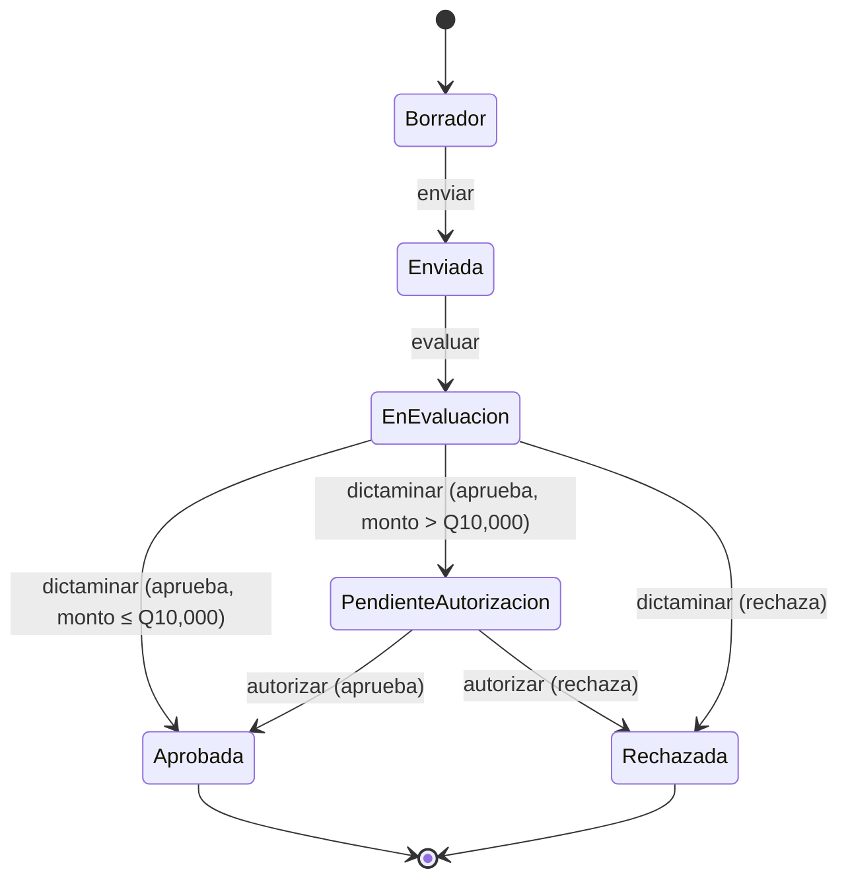

# Análisis de Impacto — Nuevos Requerimientos

**Plataforma Nacional para la Gestión Integral de Becas**
0910-037 Análisis de Sistemas II · Universidad Mariano Gálvez de Guatemala

| | |
|---|---|
| **Solicitud de cambio** | Comunicación del Ing. Mario Fuentes (Product Owner): aprobación de solicitudes de mayor monto, notificaciones por cambio de estado y auditoría de operaciones relevantes |
| **Fecha del análisis** | 30/10/2026 |
| **Base analizada** | Rama `develop`, commit `32c90ea`: 29 endpoints, 418 pruebas de backend y 97 de frontend, CI obligatorio |
| **Estado** | Análisis entregado. Implementación pendiente de las decisiones de la sección 7 |

Cada afirmación sobre el sistema actual de este documento se verificó contra el
código de `develop`, no contra la documentación.

---

## 1. Resumen

| Requerimiento | Qué existe hoy | Esfuerzo | Riesgo |
|---|---|---|---|
| **R1. Doble aprobación sobre Q10,000** | El dictamen de un solo evaluador y el patrón State. **No existe el monto**, ni se guarda quién aprobó | Alto | Medio: toca el ciclo de vida, que ya está probado |
| **R2. Notificaciones por cambio de estado** | El patrón Observer, con errores aislados por listener. **Nadie lo conecta**: hoy no se notifica a ningún estudiante | Medio | Bajo |
| **R3. Auditoría** | Nada. **El backend no usa transacciones** en ninguna operación | Alto | Alto: exige cambiar cómo se escribe en la base |

Los tres caben en la arquitectura N-capas sin cambiar su forma: no aparece una
capa nueva. Dos de ellos caen sobre patrones que el sistema ya tiene y que
fueron elegidos para este tipo de cambio:

- **R1 es un estado más en el patrón State.** El diseño original lo previó: cada
  estado decide qué acciones admite, así que agregar un paso intermedio no
  obliga a tocar los demás estados.
- **R2 es el caso de uso del patrón Observer.** "Permitir otros canales sin
  modificar la lógica" es literalmente lo que resuelve: un canal nuevo es un
  listener nuevo.
- **R3 no es un patrón, es una propiedad de la escritura.** Un registro de
  auditoría que se guarda aparte del cambio que audita puede perderse o quedar
  huérfano. Por eso exige transacciones, que hoy no existen.

---

## 2. Hallazgos sobre el sistema actual

Antes de diseñar el cambio se revisó cómo funciona hoy cada pieza involucrada.
Cuatro hallazgos condicionan el diseño.

1. **No hay monto.** La tabla `solicitudes` no tiene ninguna columna de monto,
   ni la API lo recibe, ni la pantalla lo pide. La regla de los Q10,000 no se
   puede evaluar sin agregarlo.
2. **El historial de transiciones no se guarda.** `Solicitud` lleva un
   `#historial` en memoria que se pierde al terminar cada petición. Hoy no
   queda registro persistente de quién cambió un estado ni cuándo. R1 y R3
   piden exactamente eso.
3. **Las notificaciones no llegan a nadie.** `EmailNotificationListener` existe
   y está probado, pero `hidratar()` solo lo conecta si recibe el correo del
   estudiante, y **ningún flujo se lo pasa**. Además:
   - se notifica **antes** de guardar el estado nuevo: si la escritura en la
     base falla, el estudiante ya recibió un aviso de un estado que no existe;
   - `Solicitud#notificar` atrapa los errores de cada listener, lo que cumple
     parte de R2, pero solo los **síncronos**: un envío de correo real es
     asíncrono y su error escaparía de ese `try/catch`;
   - el ANEXO 4 (EPIC-06) declara como *"ya implementado"* que una falla al
     notificar no deshace la transición. Es cierto solo para errores síncronos,
     y el ANEXO 4 se corrige con este cambio.
4. **No hay transacciones.** Cada repositorio usa `pool.query` suelto. Hoy no
   hace falta porque cada operación escribe una sola fila; con R1 y R3 una
   aprobación escribe en tres tablas, y tienen que guardarse todas o ninguna.

---

## 3. R1 — Aprobación de solicitudes de mayor monto

### 3.1 Requerimientos afectados

| Elemento | Impacto |
|---|---|
| SCRUM-36 Crear solicitud | Se agrega el **monto solicitado**, obligatorio y mayor que cero, editable solo en Borrador |
| SCRUM-53 Aprobar o rechazar | Cambia: sobre Q10,000 la aprobación del evaluador **ya no es final** |
| SCRUM-55 Resolución visible | El estudiante ve el paso intermedio *Pendiente de autorización* |
| **Historia nueva** | Autorizar una solicitud de mayor monto, por la autoridad autorizadora |
| NFR M-3 | Se amplía: toda aprobación queda asociada a su actor, con fecha, hora y resultado |

**Lectura de la regla.** "Supere los Q10,000" se interpreta como
**estrictamente mayor que 10,000**: una solicitud de exactamente Q10,000 sigue el
flujo vigente. Es el primer caso límite de las pruebas.

### 3.2 Diseño: un estado nuevo en el patrón State



- **Clase nueva `EstadoPendienteAutorizacion`**, con una sola acción permitida:
  la autorización final. Cualquier otra acción responde 409, igual que hoy.
- **`EstadoEnEvaluacion#dictaminar`** decide el estado siguiente según el monto.
  Es el único estado existente que cambia; Borrador, Enviada, Aprobada y
  Rechazada no se tocan.
- **Un rechazo en cualquiera de las dos etapas termina en Rechazada**, que es
  final: "no podrá continuar al proceso de autorización" queda garantizado por el
  estado y no por un `if`.
- "No podrá marcarse como autorizada mientras falte alguna" también lo garantiza
  el estado: desde En Evaluación no existe la transición directa a Aprobada
  cuando el monto supera el umbral.

### 3.3 Autorización: quién puede hacer cada aprobación

| Etapa | Quién | Regla nueva |
|---|---|---|
| Primera aprobación (evaluación) | El **evaluador asignado**, como hoy | — |
| Segunda aprobación (autorización) | La **autoridad autorizadora** | No puede ser la misma persona que dio la primera aprobación |

La separación de funciones se verifica en `solicitud.autorizacion.js`, que es
donde hoy se decide quién puede hacer qué, comparando el usuario contra el que
quedó registrado en la primera aprobación. Se compara por **persona**, no por
rol: alguien con dos roles tampoco puede aprobar dos veces.

### 3.4 Datos

```sql
ALTER TABLE solicitudes
    ADD COLUMN IF NOT EXISTS monto_solicitado NUMERIC(12, 2)
        CHECK (monto_solicitado > 0);

CREATE TABLE IF NOT EXISTS aprobaciones (
    id           SERIAL PRIMARY KEY,
    solicitud_id INTEGER NOT NULL REFERENCES solicitudes(id) ON DELETE CASCADE,
    usuario_id   INTEGER NOT NULL REFERENCES usuarios(id),
    etapa        VARCHAR(20) NOT NULL CHECK (etapa IN ('evaluacion', 'autorizacion')),
    resultado    VARCHAR(20) NOT NULL CHECK (resultado IN ('aprobada', 'rechazada')),
    creado_en    TIMESTAMPTZ NOT NULL DEFAULT now(),
    UNIQUE (solicitud_id, etapa)
);
```

- `UNIQUE (solicitud_id, etapa)` impide en la base una segunda decisión sobre la
  misma etapa, aunque dos peticiones lleguen a la vez.
- La regla "personas distintas" no cabe en un `CHECK` porque compara dos filas:
  se aplica en el servicio, dentro de la misma transacción que inserta la fila.
- Si la autoridad autorizadora es un rol nuevo, se agrega el valor
  `'autorizador'` a `usuarios.rol` (la columna no tiene `CHECK`, así que no hay
  migración del tipo).

### 3.5 Componentes

| Capa | Cambio |
|---|---|
| Patrones | `EstadoPendienteAutorizacion.js` nuevo; `EstadoEnEvaluacion.js` modificado; `crearEstadoDesdeNombre` reconoce el estado nuevo |
| Servicio | `solicitud.service.js`: el dictamen consulta el monto y registra la aprobación; función nueva de autorización final. `solicitud.autorizacion.js`: acción nueva y separación de funciones |
| Repositorio | `aprobacion.repository.js` nuevo; `solicitud.repository.js` lee y guarda el monto |
| API | `POST /api/solicitudes/:id/autorizacion` con `{ aprobado }`; bandeja de pendientes de autorización; el monto en la creación y en el detalle |
| Frontend | Campo de monto al crear la solicitud; bandeja y botones de la autoridad autorizadora; el estado nuevo en *Mis solicitudes* |
| Base de datos | Columna `monto_solicitado` y tabla `aprobaciones` |

---

## 4. R2 — Notificaciones por cambio de estado

### 4.1 Requerimientos afectados

| Elemento | Impacto |
|---|---|
| SCRUM-54 Notificar al estudiante | Pasa de *diseñado* a *en funcionamiento* |
| ANEXO 4, EPIC-06 | Se corrige la afirmación de que la resiliencia ya estaba implementada (hallazgo 3) |
| **Historia nueva** | El estudiante consulta sus notificaciones |

### 4.2 Diseño: el Observer que ya existe, conectado y en el orden correcto

1. **Primero se guarda, después se avisa.** El cambio de estado se confirma en la
   base y **solo entonces** se notifica. Así "si falla el envío, el cambio de
   estado se conserva" se cumple por construcción: cuando se intenta notificar,
   el cambio ya es definitivo.
2. **El evento se registra antes de enviarse.** Cada cambio de estado deja una
   fila en `notificaciones` con la solicitud, el estado anterior y el nuevo, y
   el canal. El resultado del envío (enviada, o el error) se actualiza en esa
   fila.
3. **Los errores se aíslan también en los envíos asíncronos.** Cada listener se
   ejecuta con su promesa atrapada: un servicio de correo caído deja la
   notificación marcada como fallida, sin afectar la respuesta de la petición.
4. **Canales.** Cada canal es una implementación de `INotificacionObserver`:
   - **En la aplicación** (nuevo): el estudiante ve sus avisos en una pantalla.
     No depende de ningún servicio externo, por eso es el canal que se
     implementa primero.
   - **Correo** (`EmailNotificationListener`, existente): se conecta con un
     transporte real cuando haya servidor de correo.
   - **Otros a futuro** (SMS, WhatsApp): una clase nueva, sin tocar el servicio
     de solicitudes.

### 4.3 Datos

```sql
CREATE TABLE IF NOT EXISTS notificaciones (
    id              SERIAL PRIMARY KEY,
    solicitud_id    INTEGER NOT NULL REFERENCES solicitudes(id) ON DELETE CASCADE,
    destinatario_id INTEGER NOT NULL REFERENCES usuarios(id),
    estado_anterior VARCHAR(30) NOT NULL,
    estado_nuevo    VARCHAR(30) NOT NULL,
    canal           VARCHAR(20) NOT NULL,
    enviada         BOOLEAN NOT NULL DEFAULT false,
    error           TEXT,
    leida_en        TIMESTAMPTZ,
    creado_en       TIMESTAMPTZ NOT NULL DEFAULT now()
);
```

### 4.4 Componentes

| Capa | Cambio |
|---|---|
| Patrones | `NotificacionEnAppListener.js` nuevo; `Solicitud#notificar` espera y atrapa también los errores asíncronos |
| Servicio | `aplicarTransicion` notifica **después** de persistir y conecta los listeners del estudiante dueño |
| Repositorio | `notificacion.repository.js` nuevo |
| API | `GET /api/notificaciones` (solo las del usuario en sesión) y marcar como leída |
| Frontend | Pantalla *Mis notificaciones* y un indicador de no leídas en el inicio |
| Base de datos | Tabla `notificaciones` |

---

## 5. R3 — Auditoría de operaciones relevantes

### 5.1 Requerimientos afectados

| Elemento | Impacto |
|---|---|
| **Epic nuevo** | Auditoría, con historias para registrar y para consultar |
| NFR de seguridad (ANEXO 4 §5.1) | Requisitos nuevos: inmutabilidad del registro, acceso restringido, sin secretos |
| NFR M-3 | Se cumple también para las modificaciones de datos, no solo para los estados |

### 5.2 Qué se audita

| Operación | Qué se registra además del actor, la fecha y la solicitud |
|---|---|
| Aprobación y rechazo, en cada etapa | La etapa y el resultado |
| Cambio de estado | Estado anterior y nuevo |
| Cambio del monto | Valor anterior y nuevo |
| Asignación de evaluador | El evaluador asignado |
| Subida de documento | El tipo de documento y el nombre del archivo |
| Validación de identidad al enviar | Que se validó, **con el CUI enmascarado** |

### 5.3 Datos

```sql
CREATE TABLE IF NOT EXISTS auditoria (
    id           BIGSERIAL PRIMARY KEY,
    usuario_id   INTEGER NOT NULL REFERENCES usuarios(id),
    operacion    VARCHAR(40) NOT NULL,
    solicitud_id INTEGER REFERENCES solicitudes(id),
    detalle      JSONB NOT NULL DEFAULT '{}'::jsonb,
    creado_en    TIMESTAMPTZ NOT NULL DEFAULT now()
);

-- Inmutable: nadie, ni la propia aplicación, puede cambiar ni borrar un registro.
CREATE OR REPLACE FUNCTION auditoria_inmutable() RETURNS trigger AS $$
BEGIN
    RAISE EXCEPTION 'La auditoría no se modifica ni se elimina';
END;
$$ LANGUAGE plpgsql;

DROP TRIGGER IF EXISTS auditoria_sin_cambios ON auditoria;
CREATE TRIGGER auditoria_sin_cambios
    BEFORE UPDATE OR DELETE ON auditoria
    FOR EACH ROW EXECUTE FUNCTION auditoria_inmutable();
```

- **`detalle`** guarda el dato modificado como `{ "campo", "antes", "despues" }`,
  que es lo que pide "identificar qué dato fue modificado y cuál fue el cambio".
- **La protección vive en la base**, no en el código: aunque una versión futura
  del backend tuviera un defecto, el trigger rechaza la modificación.
- **Sin `ON DELETE CASCADE`** hacia la auditoría: una solicitud con registros de
  auditoría no se puede borrar, así que su rastro no desaparece con ella.
- El `DROP TRIGGER IF EXISTS` mantiene el esquema idempotente, como el resto de
  `schema.sql`.
- **Sin secretos por diseño:** el servicio de auditoría recibe una **lista
  blanca** de campos. Nunca registra `password_hash`, tokens de sesión ni de
  recuperación. El CUI se guarda enmascarado (solo los últimos 4 dígitos).

### 5.4 Transacciones

Es el cambio de mayor riesgo del análisis. Una aprobación sobre Q10,000 escribe
el estado, la aprobación y la auditoría. Si se guardan por separado y la
tercera falla, queda una aprobación sin rastro, que es justo lo que R3 prohíbe.

Se agrega a `config/db.js` una función que ejecuta un bloque dentro de
`BEGIN`/`COMMIT` con una sola conexión, y los repositorios aceptan esa conexión
opcional. Las operaciones que no se auditan no cambian.

**Las notificaciones quedan fuera de la transacción** (sección 4.2): se envían
después del `COMMIT`, para que un servicio de avisos lento o caído no retenga
ni revierta la escritura.

### 5.5 Componentes

| Capa | Cambio |
|---|---|
| Configuración | `config/db.js`: función de transacción |
| Servicio | `auditoria.service.js` nuevo, con la lista blanca; los servicios de solicitudes, documentos y asignación lo llaman dentro de su transacción |
| Repositorio | `auditoria.repository.js` nuevo, **solo con INSERT y SELECT**; los repositorios existentes aceptan una conexión de transacción |
| API | `GET /api/auditoria`, solo administrador, filtrable por solicitud |
| Frontend | Vista de auditoría para el administrador |
| Base de datos | Tabla `auditoria` y su trigger |

---

## 6. Impacto en pruebas y documentación

### 6.1 Pruebas nuevas, una por criterio de aceptación

| Criterio | Prueba |
|---|---|
| Monto > Q10,000 exige dos aprobaciones | Aprobar como evaluador deja la solicitud en *Pendiente de autorización*, no en Aprobada |
| Monto ≤ Q10,000 sigue el flujo vigente | Caso límite: **exactamente Q10,000** queda Aprobada con una sola aprobación |
| No se autoriza mientras falte una aprobación | Autorizar una solicitud En Evaluación responde 409 |
| Se registra quién, cuándo y qué decidió | Cada aprobación deja su fila en `aprobaciones` y en `auditoria` |
| Un rechazo deja la solicitud Rechazada | Rechazo en cada etapa; después, cualquier acción responde 409 |
| La misma persona no completa ambas | El evaluador que aprobó intenta autorizar: 403 |
| Se notifica al estudiante dueño | Un cambio de estado crea su notificación, dirigida solo al dueño |
| Un error al notificar conserva el cambio | Listener que falla, síncrono y **asíncrono**: el estado queda guardado y la notificación, marcada como fallida |
| Canales nuevos sin tocar la lógica | Un listener de prueba se agrega sin modificar `solicitud.service.js` |
| Se audita con usuario, fecha, operación y solicitud | Un registro por operación de la tabla 5.2 |
| Se identifica el dato modificado | Cambio de monto con `antes` y `despues` |
| La auditoría no se modifica ni se borra | `UPDATE` y `DELETE` sobre `auditoria` fallan **contra PostgreSQL real** (en `demo-api.sh`, porque Vitest no ejecuta SQL) |
| Acceso restringido | Estudiante y evaluador reciben 403 en `GET /api/auditoria` |
| Sin secretos | Ningún registro contiene `password_hash`, tokens ni el CUI completo |

Cada prueba nueva se valida con un mutante, como el resto de la suite (ANEXO 7
§6.3). `demo-api.sh` agrega el recorrido de una solicitud mayor a Q10,000 y las
comprobaciones de la auditoría contra la base real; el CI las corre en cada PR.

### 6.2 Documentos que cambian

| Documento | Cambio |
|---|---|
| ANEXO 4 | Historias nuevas, epic de auditoría, NFR nuevos; corrección de EPIC-06 |
| ANEXO 5 | Diagrama de estados, de clases, entidad-relación y casos de uso nuevos |
| ANEXO 7 | Casos de prueba de la tabla 6.1 |
| Manual Técnico | Endpoints, tablas, variables del servidor de correo |
| Manual de Usuario | Monto, autoridad autorizadora, notificaciones, auditoría |
| `ESTADO.md`, colección de Postman, Jira | Los módulos y endpoints nuevos |

---

## 7. Decisiones que necesita el Product Owner

| # | Pregunta | Propuesta del equipo |
|---|---|---|
| 1 | ¿Quién es la **autoridad autorizadora**? | Un **rol nuevo** (`autorizador`). Si fuera el administrador, la persona que asigna evaluadores también autorizaría: se concentra el control en una sola cuenta |
| 2 | ¿El **monto** lo pide el estudiante o lo fija la convocatoria? | Lo indica el estudiante, como dice el requerimiento ("monto de beca solicitado"), con un máximo opcional por convocatoria |
| 3 | ¿Qué **canal** de notificación se exige en esta entrega? | **En la aplicación**. El correo requiere un servidor de correo y un despliegue que el proyecto no tiene (ANEXO 6, punto 7 del DoD) |
| 4 | ¿Las solicitudes que ya existen tienen monto? | Quedan sin monto y siguen el flujo vigente. Las nuevas lo exigen |
| 5 | ¿Quién más puede **consultar la auditoría**? | Solo el administrador |

---

## 8. Plan y estimación

| Bloque | Responsable propuesto | Estimación |
|---|---|---|
| Transacciones en `config/db.js` y auditoría (backend) | José Daniel Pereira | 1,5 días |
| Doble aprobación (backend) | Jonatan Santiago | 1,5 días |
| Notificaciones (backend) y este análisis | Cristopher Contreras | 1 día |
| Pantallas: monto, autorización, notificaciones, auditoría | Brayan Sujuy | 2 días |
| Pruebas de aceptación, `demo-api.sh`, manuales y ANEXO 7 | Marco Corado | 1,5 días, en paralelo |

**Orden.** Las transacciones van primero, porque la doble aprobación y la
auditoría escriben dentro de ellas. Las notificaciones son independientes y
pueden empezar ya.

**Total: 3 a 4 días de trabajo en paralelo**, con cada parte entrando por Pull
Request con revisión y CI, como el resto del proyecto.

### 8.1 Riesgos

| Riesgo | Mitigación |
|---|---|
| Las transacciones tocan repositorios ya probados | Parámetro opcional: sin él, cada repositorio funciona exactamente como hoy. La suite actual tiene que seguir pasando sin cambios |
| El estado nuevo rompe el ciclo de vida existente | Las 27 pruebas de `patterns/state.test.js` corren sin modificación, más las del estado nuevo |
| Exigir el monto rompe las solicitudes existentes | Decisión 4: el monto es nulo en las existentes y obligatorio solo al crear |
| El trigger de inmutabilidad no se prueba con Vitest | Se verifica en `demo-api.sh` contra PostgreSQL, que el CI ejecuta en cada PR |

---

*Documento sujeto a control de versiones en el repositorio del proyecto.*
