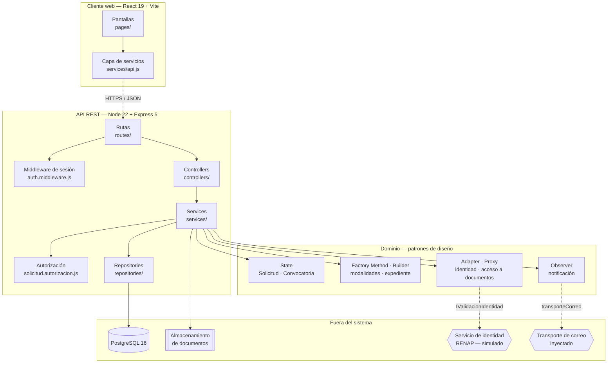
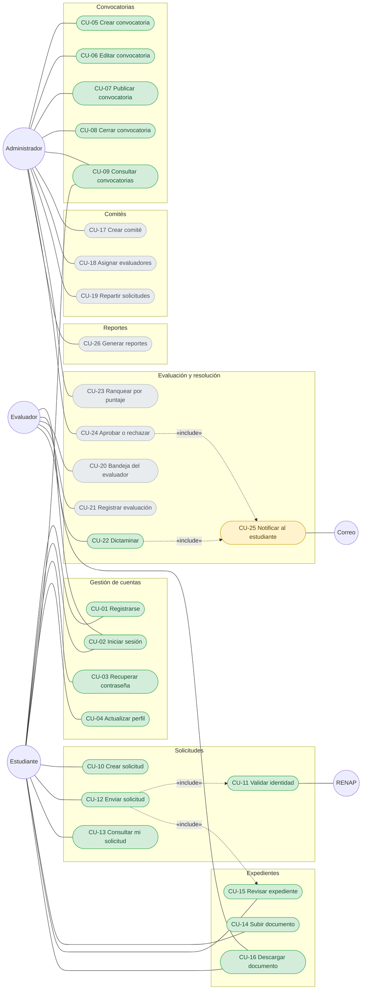
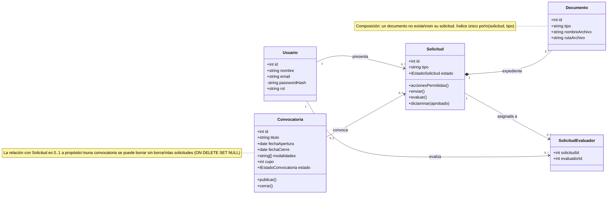

# ANEXO 5 — Documento de Diseño de Sistema Evolutivo

## 1. Información General del Proyecto

| | |
|---|---|
| **Nombre del Proyecto** | Plataforma Nacional para la Gestión Integral de Becas |
| **Curso** | 0910-037 Análisis de Sistemas II — 8º Ciclo |
| **Catedrático / Product Owner / Scrum Master** | Ing. Mario Fuentes |
| **Arquitectura y Diagrama de Componentes** | Cristopher Isaí Contreras Salazar (Arquitecto de Infraestructura) |
| **Diagrama de Clases y Patrones** | Jonatan Santiago, José Daniel Pereira Cabrera |
| **Diagrama de Casos de Uso** | Brayan David Sujuy Hernández |
| **Versión del Documento** | 1.0 |
| **Fecha de Actualización** | 22/10/2026 |

**Nota sobre el carácter evolutivo de este documento.** Los diagramas describen el
sistema **como está construido hoy**, no como se imaginó al inicio. Donde una
funcionalidad todavía no existe, se dice explícitamente en vez de dibujarla como
si existiera. Cada sección marca su estado:

- **Implementado** — hay código en `develop` y pruebas que lo cubren
- **Parcial** — la lógica existe pero falta exponerla o conectarla
- **Pendiente** — diseñado, sin código

---

## 2. Propuesta de Arquitectura del Sistema

### 2.1 Estilo arquitectónico seleccionado

**Arquitectura en Capas (N-Layer)**, con una API REST y un cliente web
desacoplado.

El backend tiene cuatro capas con una dirección de dependencia única:

```
ruta  →  controller  →  service  →  repository  →  PostgreSQL
```

La regla que no se negocia: **ninguna capa salta a otra ni invierte el sentido.**
Un controller no escribe SQL. Un repository no conoce HTTP. Un service no sabe
si lo llamó una petición web o un script.

### 2.2 Justificación de la elección

#### Alineación con los requisitos

**Razón 1 — Cinco personas trabajando en paralelo sin pisarse.** Es la razón que
más peso tuvo. Con las capas separadas, dos integrantes pueden trabajar en la
misma Historia de Usuario tocando archivos distintos: uno el service y el otro la
ruta y el controller. Esto se verificó en la práctica: las Historias SCRUM-43 y
SCRUM-44 se desarrollaron simultáneamente sobre el mismo módulo de documentos sin
un solo conflicto de *merge*, porque una vivía en el service y la otra en la capa
HTTP.

**Razón 2 — Entrega incremental, que es el pilar de Scrum que el curso exige.**
Cada Sprint agrega un módulo completo de arriba abajo —ruta, controller, service,
repository— sin tocar los módulos ya entregados. Convocatorias se agregó entero
en un Sprint sin modificar una línea de Solicitudes, salvo un punto de conexión
deliberado. Eso es posible porque las capas aíslan el cambio.

**Razón 3 — Las reglas de negocio quedan donde se pueden probar.** La capa de
service no depende de Express ni de `pg`. Por eso 158 de las 314 pruebas del
backend ejercitan reglas de negocio reales mockeando únicamente el repositorio,
sin levantar un servidor ni una base de datos. Si las reglas vivieran en los
controllers, probarlas exigiría simular objetos `req`/`res` para cada caso, y la
suite sería lenta y frágil.

**Razón 4 — La lógica del dominio es un ciclo de vida, no un CRUD.** Una
solicitud de beca pasa por cinco estados con transiciones restringidas, y una
convocatoria por tres. Eso pide una capa de dominio con identidad propia, que es
exactamente donde viven los patrones (sección 2.6). Un CRUD plano habría
dispersado las reglas de transición en condicionales por todo el código.

#### Tecnologías clave

| Capa | Tecnología | Por qué |
|---|---|---|
| Cliente web | React 19 + Vite, `react-router-dom`, `axios` | Vite da recarga inmediata, lo que importa con un equipo aprendiendo |
| API | Node.js 22 con Express 5, módulos ES | Un solo lenguaje en todo el proyecto: nadie cambia de contexto mental entre frontend y backend |
| Dominio | JavaScript con clases | Los patrones se expresan con clases e interfaces explícitas |
| Persistencia | PostgreSQL 16 vía `pg`, SQL escrito a mano | Sin ORM, a propósito: ver trade-off 3 |
| Seguridad | `jsonwebtoken` (JWT), `bcryptjs` | Sesión sin estado en el servidor |
| Archivos | `multer` en memoria | El service decide antes de que algo toque el disco |
| Pruebas | Vitest | Mismo *runner* en backend y frontend |

#### Ventajas principales

1. **Mantenibilidad.** Un defecto se localiza por su síntoma. Si el código HTTP
   es incorrecto, está en el controller; si la regla de negocio falla, en el
   service; si los datos salen mal, en el repository. No hay que leer todo el
   módulo.
2. **Testabilidad.** Demostrada: 314 pruebas en el backend, de las cuales 126 no
   usan ningún mock porque el dominio no tiene dependencias que mockear.
3. **Curva de aprendizaje.** Las cuatro capas se explican en una pizarra en cinco
   minutos. Con cinco personas en octavo ciclo, eso vale más que la elegancia.
4. **Sustituibilidad real, verificada.** La validación de identidad contra RENAP
   se consume a través de una interfaz (`IValidacionIdentidad`). Hoy la
   implementa un cliente simulado; cambiarlo por el servicio real no toca ni el
   service ni el controller. No es una promesa de diseño: es la razón por la que
   el proyecto avanza sin tener credenciales de RENAP.

#### Compromisos y desventajas consideradas (trade-offs)

Se declaran los costos aceptados, no solo los beneficios.

**Trade-off 1 — Ceremonia para operaciones triviales.** Una lectura simple
atraviesa cuatro archivos. Para `GET /api/solicitudes/tipos`, que solo devuelve
tres cadenas, hay ruta, controller y service. Es desproporcionado y lo sabemos.
Se aceptó porque la alternativa —permitir atajos "solo para los casos simples"—
erosiona la regla, y una vez que hay excepciones nadie sabe dónde buscar nada.
La regla uniforme cuesta líneas y ahorra discusiones.

**Trade-off 2 — Se evaluó Arquitectura Hexagonal y se descartó.** Habría dado
inversión de dependencias completa, con puertos y adaptadores en todo el
perímetro. Se descartó porque exige disciplina de inyección de dependencias en
cada módulo y el equipo no la tiene todavía; mal aplicada produce capas de
indirección que nadie entiende. Se tomó la idea donde más valía —la interfaz de
validación de identidad— sin pagar el costo en todo el sistema. Consecuencia
asumida: los services importan sus repositories directamente, así que para
probarlos hay que mockear el módulo, no inyectarlo.

**Trade-off 3 — SQL a mano, sin ORM.** Un ORM habría dado migraciones y menos
código repetido. Se decidió escribir SQL porque el curso evalúa el diseño de
base de datos y un ORM lo esconde detrás de decoradores. Costos reales que esto
nos cobró: (a) el esquema se mantiene a mano en `schema.sql`, que se escribió
idempotente para poder re-aplicarlo; (b) **ninguna prueba automatizada ejecuta
SQL**, porque el repositorio siempre está mockeado, de modo que un error de
consulta solo lo atrapa el recorrido manual del Nivel 3 del Plan de Pruebas.
Esta segunda consecuencia es la deuda técnica más seria del proyecto y está
declarada como tal.

**Trade-off 4 — Monolito, no microservicios.** Se consideró separar Convocatorias,
Solicitudes y Evaluaciones en servicios independientes. Se descartó: con cinco
desarrolladores y un semestre, el costo de despliegue, comunicación entre
servicios y consistencia distribuida supera cualquier beneficio. La arquitectura
en capas deja los límites de módulo marcados, así que si algún día hiciera falta
extraer un servicio, la frontera ya está dibujada.

**Trade-off 5 — JWT sin estado, sin revocación.** Un token válido lo sigue siendo
hasta que vence (`JWT_EXPIRES_IN`, hoy una hora). No hay lista de revocación, así
que no se puede cerrar la sesión de un usuario comprometido antes de ese plazo.
Se aceptó por simplicidad, con la vigencia corta como mitigación.

### 2.3 Capas del backend, y qué puede hacer cada una

| Capa | Dónde vive | Puede | No puede |
|---|---|---|---|
| **Rutas** | `src/routes/` | Mapear URL a controller, aplicar el middleware de sesión y los límites de subida | Contener lógica |
| **Controllers** | `src/controllers/` | Leer `req`, traducir errores de dominio a códigos HTTP, responder | Escribir SQL, decidir reglas de negocio |
| **Services** | `src/services/` | Orquestar el dominio, autorizar, decidir reglas | Conocer HTTP o SQL |
| **Dominio** | `src/patterns/`, `src/validators/` | Representar estados, modalidades, expedientes y sus reglas | Conocer la base de datos |
| **Repositories** | `src/repositories/` | Ejecutar SQL y devolver filas | Decidir reglas o autorizar |

Dos convenciones que sostienen esto y que se verifican en revisión de código:

1. **Un error de negocio lleva `status` a propósito.** Un error sin `status` se
   considera inesperado y su mensaje **no sale al cliente**, porque los errores
   de PostgreSQL traen nombres de tablas y de restricciones. Hay 8 pruebas
   dedicadas solo a esto.
2. **El identificador del usuario se traduce en el borde.** El JWT lo guarda en
   `sub`; el dominio lo llama `id`. La traducción ocurre en el controller, en un
   solo lugar. Sin ella, el dueño de una solicitud no se reconoce como tal y
   recibe 403 sobre su propio expediente.

### 2.4 Diagrama de Componentes

Muestra los bloques de alto nivel y la dirección de sus dependencias. Las flechas
apuntan **hacia** lo que se depende.



**Lo que el diagrama demuestra:**

- **El cliente solo conoce la capa de rutas.** No hay ninguna dependencia del
  frontend hacia un service o un repository.
- **Las dependencias no se invierten.** No existe ninguna flecha de `REPO` hacia
  `SERV`, ni de `SERV` hacia `CTRL`.
- **El dominio no toca el exterior.** Ningún patrón apunta a PostgreSQL. El
  dominio recibe datos ya cargados y devuelve decisiones.
- **Las dos únicas salidas a sistemas externos son interfaces** (líneas
  punteadas): `IValidacionIdentidad` para RENAP y `transporteCorreo` para el
  correo. Por eso ambas se pueden sustituir sin tocar reglas de negocio, y por eso
  el proyecto avanza sin credenciales de RENAP ni servidor de correo.
- **La autorización cuelga del service, no del middleware.** El middleware solo
  confirma que hay sesión. Quién puede actuar sobre **este** registro lo decide el
  dominio. La diferencia es la que causó el defecto crítico de SCRUM-35.

---

## 3. Diagrama de Casos de Uso

### 3.1 Actores

| Actor | Tipo | Descripción |
|---|---|---|
| **Estudiante** | Primario | Solicita una beca, arma su expediente y consulta su resolución |
| **Evaluador** | Primario | Revisa los expedientes que le fueron asignados y emite su dictamen |
| **Administrador** | Primario | Publica convocatorias, conforma comités y resuelve las adjudicaciones. Es el rol que ejerce MINEDUC |
| **Servicio de Identidad (RENAP)** | Secundario | Confirma que el CUI del solicitante corresponde a una persona real |
| **Transporte de correo** | Secundario | Entrega las notificaciones de cambio de estado |

Los dos actores secundarios son sistemas, no personas, y el sistema los consume a
través de interfaces, de modo que ambos son sustituibles (sección 2.4).

### 3.2 Diagrama

Verde: implementado y con pruebas. Amarillo: la lógica existe pero falta
conectarla o exponerla. Gris: pendiente.



### 3.3 Detalle de los casos de uso

El detalle se da completo para los casos implementados, porque sus flujos están
verificados con pruebas y se pueden auditar contra el código. Para los pendientes
se da el contrato acordado, que es lo que se usará al implementarlos.

#### Gestión de cuentas

**CU-01 — Registrarse** · *Implementado* · `POST /api/auth/register`

| | |
|---|---|
| **Actor** | Estudiante (cualquier visitante) |
| **Precondición** | Ninguna. Es público |
| **Flujo principal** | 1. El actor envía nombre, correo y contraseña.<br>2. El sistema valida que el dominio del correo esté en `ALLOWED_EMAIL_DOMAINS`.<br>3. Valida la política de contraseñas.<br>4. Calcula el hash bcrypt de la contraseña.<br>5. Crea la cuenta con rol `estudiante` y responde 201 |
| **Flujos alternativos** | **2a.** Dominio no institucional → **400**, y el mensaje enumera los dominios aceptados.<br>**3a.** Contraseña débil → **400** con el motivo.<br>**5a.** El correo ya existe → **409** |
| **Postcondición** | Existe una fila en `usuarios` con `password_hash`. **La contraseña en claro no se guarda ni se registra en ningún log** |
| **Regla que se verifica** | El rol se asigna del lado del servidor. Un cliente no puede registrarse como `administrador` enviando el campo |

**CU-02 — Iniciar sesión** · *Implementado* · `POST /api/auth/login`

| | |
|---|---|
| **Actor** | Estudiante, Evaluador, Administrador |
| **Precondición** | La cuenta existe |
| **Flujo principal** | 1. El actor envía correo y contraseña.<br>2. El sistema compara contra el hash.<br>3. Firma un JWT con `sub`, correo y rol, con la vigencia de `JWT_EXPIRES_IN`.<br>4. Responde 200 con el token |
| **Flujo alternativo** | **2a.** Credenciales incorrectas → **401** con el mensaje `Credenciales inválidas.` |
| **Postcondición** | El actor posee un token que vence |
| **Regla que se verifica** | Una contraseña incorrecta y un correo inexistente devuelven **el mismo mensaje**, a propósito: distinguirlos permitiría averiguar qué correos están registrados |

**CU-03 — Recuperar contraseña** · *Implementado* · `POST /api/auth/forgot-password`, `POST /api/auth/reset-password`

| | |
|---|---|
| **Actor** | Estudiante |
| **Flujo principal** | 1. El actor pide la recuperación con su correo.<br>2. El sistema genera un token aleatorio, guarda **su hash** y una fecha de vencimiento (`RESET_TOKEN_EXPIRES_MIN`).<br>3. El actor envía el token y la contraseña nueva.<br>4. El sistema valida vigencia y hash, actualiza la contraseña e **invalida el token** |
| **Flujos alternativos** | **4a.** Token vencido → 400.<br>**4b.** Token ya usado → 400.<br>**4c.** Token que no corresponde → 400 |
| **Postcondición** | La contraseña cambió y el token no sirve una segunda vez |
| **Regla que se verifica** | En base de datos se guarda el **hash** del token, no el token. Si alguien lee la tabla no puede usarlo |

**CU-04 — Actualizar perfil** · *Implementado* · `PUT /api/usuarios/:id/perfil`

| | |
|---|---|
| **Actor** | Estudiante, Evaluador, Administrador |
| **Precondición** | Sesión activa |
| **Flujo principal** | El actor modifica sus datos de perfil; el sistema valida y persiste |
| **Flujo alternativo** | Intento de modificar el perfil de otro usuario → **403** |
| **Postcondición** | Los datos del propio perfil quedan actualizados |

#### Convocatorias

**CU-05 — Crear convocatoria** · *Implementado* · `POST /api/convocatorias`

| | |
|---|---|
| **Actor** | Administrador |
| **Precondición** | Sesión con rol `administrador` |
| **Flujo principal** | 1. El actor envía título, fechas, modalidades y cupo.<br>2. El sistema valida que la fecha de cierre no sea anterior a la de apertura.<br>3. La convocatoria **nace en `Borrador`**, no visible al público.<br>4. Responde 201 |
| **Flujos alternativos** | **1a.** El actor no es administrador → **403**.<br>**2a.** Fechas incoherentes → **400**, y la restricción CHECK del esquema lo impide también a nivel de base de datos |
| **Postcondición** | Existe una convocatoria en `Borrador` que no acepta solicitudes |
| **Patrón aplicado** | **State** (ciclo de la convocatoria) |

**CU-06 — Editar convocatoria** · *Implementado* · `PATCH /api/convocatorias/:id`

| | |
|---|---|
| **Actor** | Administrador |
| **Precondición** | La convocatoria está en `Borrador` |
| **Flujo principal** | El actor modifica los campos; el sistema valida y persiste |
| **Flujo alternativo** | La convocatoria está `Publicada` o `Cerrada` → **409**. El estado `Publicada` declara `admiteEdicion = false`, de modo que **la negativa la decide el estado, no un condicional en el service** |
| **Postcondición** | La convocatoria sigue en `Borrador` con los datos nuevos |

**CU-07 — Publicar convocatoria** · *Implementado* · `POST /api/convocatorias/:id/publicar`

| | |
|---|---|
| **Actor** | Administrador |
| **Precondición** | La convocatoria está en `Borrador` y tiene todos sus campos obligatorios |
| **Flujo principal** | 1. El sistema verifica los campos exigidos para publicar.<br>2. Transiciona `Borrador → Publicada`.<br>3. Desde ese momento la convocatoria es visible sin sesión y acepta solicitudes |
| **Flujos alternativos** | **1a.** Faltan campos → **400** con el arreglo `faltantes`, que nombra cuáles.<br>**2a.** La convocatoria ya está `Publicada` o `Cerrada` → **409** |
| **Postcondición** | `admiteSolicitudes = true` y `admiteEdicion = false` |

**CU-08 — Cerrar convocatoria** · *Implementado* · `POST /api/convocatorias/:id/cerrar`

| | |
|---|---|
| **Actor** | Administrador |
| **Precondición** | La convocatoria está `Publicada` |
| **Flujo principal** | Transiciona `Publicada → Cerrada` |
| **Flujo alternativo** | Ya está `Cerrada` → **409**. `Cerrada` es estado final y no admite ninguna acción |
| **Postcondición** | No acepta solicitudes nuevas, **pero conserva las que ya existían** |

**CU-09 — Consultar convocatorias** · *Implementado* · `GET /api/convocatorias`, `GET /api/convocatorias/:id`

| | |
|---|---|
| **Actor** | Estudiante, Administrador, visitante sin sesión |
| **Flujo principal** | El sistema devuelve las convocatorias **visibles para quien pregunta**: sin sesión de administrador, solo las `Publicada`; con ella, todas |
| **Postcondición** | Ninguna. Es una lectura |
| **Regla que se verifica** | Una convocatoria en `Borrador` no se filtra al público. El filtrado ocurre en el service, no en el cliente |

#### Solicitudes

**CU-10 — Crear solicitud** · *Implementado* · `POST /api/solicitudes`

| | |
|---|---|
| **Actor** | Estudiante |
| **Precondición** | Sesión activa. Si se indica convocatoria, debe estar `Publicada` y admitir la modalidad pedida |
| **Flujo principal** | 1. El actor envía la modalidad y, opcionalmente, la convocatoria.<br>2. `SolicitudFactory` resuelve la modalidad y con ella los documentos que exigirá.<br>3. Si hay convocatoria, el sistema verifica que esté abierta y admita esa modalidad.<br>4. La solicitud **nace en `Borrador`**, con la modalidad persistida.<br>5. Responde 201 con el estado y las acciones permitidas |
| **Flujos alternativos** | **2a.** Modalidad desconocida → **400**, y el mensaje enumera las válidas.<br>**3a.** Convocatoria en `Borrador` o `Cerrada` → **409** |
| **Postcondición** | Existe una solicitud en `Borrador` cuya columna `tipo` **no** es nula |
| **Patrones aplicados** | **Factory Method** (modalidad) y **State** (estado inicial) |
| **Nota de diseño** | La modalidad se persiste. Mientras no se persistía, la validación de tipo de documento de CU-14 quedaba sin efecto porque no había con qué comparar |

**CU-11 — Validar identidad contra RENAP** · *Implementado* · `RenapAdapter`

| | |
|---|---|
| **Actores** | Estudiante (iniciador), Servicio de Identidad RENAP (secundario) |
| **Estado** | Conectado al envío (CU-12) desde SCRUM-38. Se consume por la interfaz `IValidacionIdentidad` a través de `identidad.service` |
| **Hueco que se encontró** | Este caso figuraba como "solo falta conectarlo", pero **el sistema no guardaba el CUI en ninguna tabla**: ni el registro ni la aplicación lo pedían. Se resolvió pidiéndolo al enviar y guardándolo en `solicitudes.cui` (nullable), sin tocar `usuarios` |
| **Flujo principal** | 1. El estudiante escribe su CUI al enviar; puede llevar espacios o guiones.<br>2. El sistema envía el CUI de 13 dígitos al servicio de identidad.<br>3. El servicio responde con el código de resultado.<br>4. El adaptador traduce esa respuesta al vocabulario del dominio.<br>5. El sistema compara el nombre de RENAP con el del dueño de la solicitud: **cada palabra del nombre registrado debe aparecer en el de RENAP, con un mínimo de dos** ("Ana López" coincide con "ANA MARIA LOPEZ GARCIA") |
| **Flujos alternativos** | **1a.** Sin CUI o con formato inválido → `IdentidadNoValidaError` → **400**, sin consultar RENAP.<br>**3a.** CUI no encontrado → `IdentidadNoValidaError` → **400**.<br>**3b.** El servicio no responde → `ServicioIdentidadNoDisponibleError` → **503**, y el envío se puede reintentar.<br>**5a.** El nombre no coincide → **400**. El mensaje **no revela** el nombre que tiene RENAP para ese CUI |
| **Postcondición** | El CUI validado, normalizado a 13 dígitos, queda en `solicitudes.cui` |
| **Patrón aplicado** | **Adapter**. Hoy la interfaz la implementa un cliente simulado; el cambio al servicio real no toca el service ni el controller |

**CU-12 — Enviar solicitud** · *Implementado* · `POST /api/solicitudes/:id/enviar` con `{ cui }`

| | |
|---|---|
| **Actor** | Estudiante, y solo el dueño |
| **Precondición** | La solicitud está en `Borrador` y el expediente está completo |
| **Flujo principal** | 1. El sistema autoriza: **solo el dueño puede enviar**.<br>2. Comprueba que el estado admita el envío.<br>3. Revisa el expediente (CU-15).<br>4. Valida la identidad contra RENAP (CU-11).<br>5. Transiciona `Borrador → Enviada` y guarda el CUI en el mismo UPDATE.<br>6. Notifica al estudiante (CU-25) |
| **Flujos alternativos** | **1a.** Lo intenta un tercero → **403** `No puede enviar una solicitud ajena.`<br>**2a.** La solicitud no está en `Borrador` → **409**.<br>**3a.** Expediente incompleto → **400** con `faltantes`.<br>**4a.** CUI inválido, inexistente o de otra persona → **400**.<br>**4b.** RENAP no responde → **503**; la solicitud sigue en `Borrador` y se puede reintentar |
| **Postcondición** | La solicitud queda en `Enviada`, con el CUI con que se envió, y **sus datos pasan a solo lectura** |
| **Nota de diseño** | El orden es deliberado. RENAP va al final porque es la única llamada externa: no se consulta si otra regla ya rechazó el envío. Un tercero recibe 403 antes de enterarse del estado o del expediente ajeno |

**CU-13 — Consultar mi solicitud** · *Implementado* · `GET /api/solicitudes`, `GET /api/solicitudes/:id`

| | |
|---|---|
| **Actor** | Estudiante (dueño), Evaluador asignado, Administrador |
| **Flujo principal** | El sistema devuelve el estado actual y **las acciones que ese estado admite**, de modo que el cliente no tiene que deducirlas |
| **Flujo alternativo** | Un tercero sin relación con la solicitud → **403** |
| **Postcondición** | Ninguna. Es una lectura |
| **Regla que se verifica** | Un estado final devuelve `accionesPermitidas: []`. El cliente puede deshabilitar botones sin conocer el ciclo de vida |

#### Expedientes

**CU-14 — Subir documento** · *Implementado* · `POST /api/documentos`

| | |
|---|---|
| **Actor** | Estudiante (dueño) o Administrador |
| **Precondición** | La solicitud existe y está en `Borrador` |
| **Flujo principal** | 1. El actor envía el archivo y el tipo de documento.<br>2. `multer` lo recibe **en memoria** y corta la petición si pasa de 5 MB.<br>3. El service autoriza y valida que el tipo corresponda a la modalidad.<br>4. El sistema **genera el nombre en disco**, conservando solo la extensión si está en la lista blanca.<br>5. Escribe el archivo y registra la fila, guardando el nombre original aparte |
| **Flujos alternativos** | **2a.** Supera 5 MB → **413**.<br>**2b.** Viene en otro campo → **400**.<br>**3a.** Solicitud ajena → **403**.<br>**3b.** La solicitud ya no está en `Borrador` → **409**.<br>**3c.** El tipo no corresponde a la modalidad → **400**.<br>**4a.** Extensión fuera de la lista blanca → **400**.<br>**5a.** Ya existe un documento de ese tipo → **409**, por índice único |
| **Postcondición** | El archivo está en disco con un nombre generado por el servidor, y la ruta guardada es **relativa y con barras normales** |
| **Decisiones de diseño verificadas** | **(a)** `multer` usa memoria y no disco, para que **nada se escriba antes de que el service decida**; con disco, un rechazo dejaría basura.<br>**(b)** El nombre lo genera el servidor, así que `../../index.js` no puede escribir fuera del directorio y `dpi.pdf.sh` no puede quedar como ejecutable.<br>**(c)** La ruta se arma con `path.posix`, porque `path.join` producía `exp\7\x.pdf` en Windows y la ruta se guarda en base de datos |

**CU-15 — Revisar expediente** · *Implementado* · `POST /api/expedientes/revision`, `POST /api/expedientes`

| | |
|---|---|
| **Actor** | Estudiante |
| **Flujo principal** | 1. `ExpedienteBuilder` arma el expediente con los documentos presentes.<br>2. Si falta alguno exigido por la modalidad, informa **exactamente cuáles** |
| **Flujos alternativos** | Expediente incompleto: la revisión responde `completo: false` con `faltantes`; el armado formal lanza `ExpedienteIncompletoError` → **400** |
| **Postcondición** | Ninguna en la revisión. Es deliberadamente consultable **sin** cerrar nada, para que el estudiante sepa qué le falta antes de intentar enviar |
| **Patrón aplicado** | **Builder** |

**CU-16 — Descargar documento** · *Implementado* · `GET /api/documentos/:id/descargar`

| | |
|---|---|
| **Actor** | Estudiante (dueño), Evaluador asignado, Administrador |
| **Precondición** | Sesión activa |
| **Flujo principal** | 1. El middleware confirma que hay sesión.<br>2. **`DocumentoProxy` decide si este actor puede ver este documento**, consultando la asignación de evaluadores.<br>3. Si procede, `DocumentoReal` lee el archivo y se entrega |
| **Flujo alternativo** | **2a.** Sin permiso → **403**, y **el archivo real nunca se lee del disco** |
| **Postcondición** | Ninguna |
| **Patrón aplicado** | **Proxy**. Que el archivo no se lea cuando se deniega el acceso es la evidencia de que el Proxy interviene antes del objeto real, y no después |
| **Verificado de extremo a extremo** | El recorrido del Nivel 3 comprueba los cuatro casos contra PostgreSQL real: dueño 200, evaluador asignado 200, otro estudiante 403, evaluador ajeno 403 |

#### Comités · *Pendientes*

**CU-17 — Crear comité**, **CU-18 — Asignar evaluadores**, **CU-19 — Repartir solicitudes**

| | |
|---|---|
| **Actor** | Administrador |
| **Estado** | Sin código. La tabla `solicitud_evaluadores` ya existe y es la que consulta el Proxy, de modo que la asignación hoy se siembra por SQL |
| **Reglas acordadas** | Un comité necesita **al menos dos** evaluadores para recibir solicitudes · Un evaluador no puede estar dos veces en el mismo comité · **Un evaluador no puede recibir su propia solicitud** si además es estudiante |
| **Dependencia** | Bloquea CU-20 y CU-21 |

#### Evaluación y resolución

**CU-20 — Bandeja del evaluador** · *Pendiente*

| | |
|---|---|
| **Actor** | Evaluador |
| **Flujo esperado** | Lista las solicitudes que le fueron asignadas y le faltan por evaluar |
| **Dependencia** | CU-19 |

**CU-21 — Registrar evaluación** · *Pendiente*

| | |
|---|---|
| **Actor** | Evaluador |
| **Reglas acordadas** | Puntaje entre 0 y 100 por criterio · No puede evaluar una solicitud que no le fue asignada · No puede evaluar dos veces la misma solicitud |
| **Nota** | La segunda regla **ya está implementada** en la capa de autorización; lo que falta es la entidad de evaluación con sus criterios y puntajes |

**CU-22 — Dictaminar** · *Implementado* · `POST /api/solicitudes/:id/evaluar`, `POST /api/solicitudes/:id/dictamen`

| | |
|---|---|
| **Actor** | Evaluador asignado, o Administrador |
| **Precondición** | Para evaluar: la solicitud está `Enviada`. Para dictaminar: está `En Evaluación` |
| **Flujo principal** | 1. El sistema autoriza: **rol `evaluador` y asignado a esta solicitud**.<br>2. Transiciona `Enviada → En Evaluación`, o `En Evaluación → Aprobada`/`Rechazada`.<br>3. Notifica al estudiante (CU-25) |
| **Flujos alternativos** | **1a.** El actor no es evaluador → **403** `Solo un evaluador asignado puede evaluar o dictaminar la solicitud.`<br>**1b.** Es evaluador pero no de esta solicitud → **403** `No está asignado como evaluador de esta solicitud.`<br>**2a.** La solicitud está en otro estado → **409** |
| **Postcondición** | La solicitud queda en `Aprobada` o `Rechazada`, **estados finales que no admiten ninguna acción** |
| **El orden de las revisiones es deliberado** | Primero **quién**, después **en qué estado**. Un estudiante que pide un dictamen sobre su propio `Borrador` recibe **403, no 409**: devolverle 409 le informaría que la acción le estaría permitida en otro estado, lo cual es falso. El 409 del patrón State solo aparece cuando quien pide la acción **sí tiene derecho a ella** |
| **Antecedente** | Este caso de uso contenía el defecto crítico del proyecto: antes de la corrección de SCRUM-35, **cualquier** usuario con sesión podía dictaminar **cualquier** solicitud por su identificador, de modo que un estudiante podía aprobar su propia beca. Se reprodujo contra PostgreSQL real antes y después del arreglo |

**CU-23 — Ranquear por puntaje**, **CU-24 — Aprobar o rechazar** · *Pendientes*

| | |
|---|---|
| **Actor** | Administrador |
| **Reglas acordadas** | **No se puede aprobar más allá del cupo de la convocatoria** · Un rechazo exige **motivo escrito** · La decisión es **irreversible** |
| **Nota** | La irreversibilidad ya la garantiza el patrón State: `Aprobada` y `Rechazada` son finales. Lo que falta es el cupo, el motivo y el ordenamiento por puntaje |

**CU-25 — Notificar al estudiante** · *Parcial*

| | |
|---|---|
| **Actores** | Sistema (iniciador), Transporte de correo (secundario) |
| **Flujo principal** | 1. Una transición se completa.<br>2. El sistema avisa a sus observadores.<br>3. `EmailNotificationListener` compone el aviso y lo entrega al transporte |
| **Flujo alternativo** | **3a.** El envío falla → se registra y **la transición se mantiene**. La notificación no puede deshacer un cambio de estado ya persistido |
| **Patrón aplicado** | **Observer**. El transporte se inyecta, así que en pruebas es una función espía y en producción sería un servidor de correo |
| **Lo que falta** | El transporte real. Hoy, si no se inyecta uno, el aviso no se envía a ninguna parte |
| **Regla que se verifica** | Si la transición es **rechazada**, no se notifica a nadie. Solo un cambio efectivo genera aviso |

#### Reportes

**CU-26 — Generar reportes** · *Pendiente*

| | |
|---|---|
| **Actor** | Administrador |
| **Flujo esperado** | Reporte de solicitudes por convocatoria, con su estado y su resolución |
| **Dependencia** | Necesita que CU-17 a CU-24 existan con datos reales dentro. Es el último de la cadena |

---

## 4. Diagrama de Clases — Modelo de Dominio

### 4.1 Entidades de negocio y sus relaciones

Las entidades que el negocio reconoce, con la multiplicidad de sus relaciones.



**Decisiones de modelado que conviene justificar:**

- **`Documento` es composición, no asociación.** Un documento no tiene sentido
  fuera de su expediente, y el índice único sobre `(solicitud_id, tipo)` impide
  dos documentos del mismo tipo en una misma solicitud.
- **La relación `Convocatoria → Solicitud` es `0..1`.** Una solicitud puede no
  tener convocatoria, y borrar una convocatoria **no** borra sus solicitudes
  (`ON DELETE SET NULL`). Perder el histórico de solicitudes por eliminar un
  período administrativo sería inaceptable.
- **`SolicitudEvaluador` es una entidad y no un simple arreglo.** Es la tabla que
  consulta el Proxy para decidir quién puede ver un expediente, de modo que la
  asignación es un hecho del dominio con consecuencias de seguridad.
- **El rol vive en `Usuario` y no en una jerarquía de herencia.** Se evaluó
  `Estudiante`/`Evaluador`/`Administrador` como subclases y se descartó: una
  misma persona puede ser estudiante en una convocatoria y evaluador en otra, y
  con herencia eso exigiría dos filas para la misma persona.

### 4.2 Los seis patrones de diseño en el dominio

El curso exige un mínimo de dos patrones creacionales, dos estructurales y dos de
comportamiento. El proyecto implementa exactamente dos de cada categoría, y
ninguno es decorativo: cada uno resuelve un problema que el sistema tenía.

```mermaid
classDiagram
    direction TB

    class IEstadoSolicitud {
        <<interface>>
        +nombre
        +accionesPermitidas
        +enviar(solicitud)
        +evaluar(solicitud)
        +dictaminar(solicitud, aprobado)
    }
    class EstadoBorrador
    class EstadoEnviada
    class EstadoEnEvaluacion
    class EstadoAprobada
    class EstadoRechazada

    IEstadoSolicitud <|.. EstadoBorrador
    IEstadoSolicitud <|.. EstadoEnviada
    IEstadoSolicitud <|.. EstadoEnEvaluacion
    IEstadoSolicitud <|.. EstadoAprobada
    IEstadoSolicitud <|.. EstadoRechazada

    class IEstadoConvocatoria {
        <<interface>>
        +nombre
        +admiteSolicitudes
        +admiteEdicion
        +publicar(convocatoria)
        +cerrar(convocatoria)
    }
    class EstadoBorradorConvocatoria
    class EstadoPublicada
    class EstadoCerrada

    IEstadoConvocatoria <|.. EstadoBorradorConvocatoria
    IEstadoConvocatoria <|.. EstadoPublicada
    IEstadoConvocatoria <|.. EstadoCerrada

    class SolicitudFactory {
        <<factory>>
        +crearSolicitud(tipo)$
    }
    class SolicitudBeca {
        <<abstract>>
        +tipo
        +documentosRequeridos
        +nivelTituloRequerido
    }
    class SolicitudNivelMedio
    class SolicitudUniversitaria
    class SolicitudPosgrado

    SolicitudBeca <|-- SolicitudNivelMedio
    SolicitudBeca <|-- SolicitudUniversitaria
    SolicitudBeca <|-- SolicitudPosgrado
    SolicitudFactory ..> SolicitudBeca : produce

    class ExpedienteBuilder {
        <<builder>>
        +agregarDNI(numero)
        +agregarTitulo(datos)
        +agregarCarta(datos)
        +build()
    }
    ExpedienteBuilder ..> SolicitudBeca : consulta requisitos

    class IDocumento {
        <<interface>>
        +descargar()
    }
    class DocumentoProxy {
        +tieneAcceso()
        +descargar()
    }
    class DocumentoReal {
        +descargar()
    }
    IDocumento <|.. DocumentoProxy
    IDocumento <|.. DocumentoReal
    DocumentoProxy --> DocumentoReal : delega solo si\ntieneAcceso()

    class IValidacionIdentidad {
        <<interface>>
        +validar(cui)
    }
    class RenapAdapter
    class RenapClienteSimulado
    IValidacionIdentidad <|.. RenapAdapter
    RenapAdapter --> RenapClienteSimulado : adapta

    class INotificacionObserver {
        <<interface>>
        +notificar(mensaje, contexto)
    }
    class EmailNotificationListener
    INotificacionObserver <|.. EmailNotificationListener
```



| Patrón | Categoría | Problema que resuelve | Evidencia de que no es decorativo |
|---|---|---|---|
| **Factory Method** | Creacional | Tres modalidades de beca con documentación distinta | Agregar una modalidad es una clase nueva. El catálogo que consume el frontend **sale de la fábrica**, no de una lista escrita a mano, así que no pueden desincronizarse |
| **Builder** | Creacional | Un expediente se arma por partes y solo al final se sabe si está completo | Informa **exactamente qué falta**, no solo que falta algo. Es consultable sin cerrar nada, para que el estudiante lo sepa antes de intentar enviar |
| **Adapter** | Estructural | El servicio de identidad habla códigos numéricos; el dominio habla de errores | El proyecto avanza **sin credenciales de RENAP**. Cambiar el cliente simulado por el real no toca service ni controller |
| **Proxy** | Estructural | Quién puede ver un documento depende de la asignación, no solo del rol | Al denegar, **el archivo real nunca se lee del disco**. Esa es la prueba de que el Proxy interviene antes del objeto real |
| **State** | Comportamiento | Dos ciclos de vida con transiciones restringidas | Gobierna **dos** entidades: Solicitud (5 estados) y Convocatoria (3). Un estado final devuelve `accionesPermitidas: []`, así que el cliente no replica las reglas |
| **Observer** | Comportamiento | Avisar al estudiante sin que el aviso pueda deshacer la transición | Si el envío falla, **la transición se mantiene**. Si la transición es rechazada, **no se notifica a nadie** |

El detalle completo de cada patrón está en `docs/justificacion-patrones.md`.

### 4.3 Cómo el dominio se relaciona con la persistencia

El dominio **no conoce** la base de datos. El service es el único que traduce
entre una fila y un objeto de dominio:

```
fila de PostgreSQL          service                       dominio
──────────────────          ───────                       ───────
estado: 'En Evaluación'  →  crearEstadoDesdeNombre()  →   EstadoEnEvaluacion
tipo:   'universitaria'  →  SolicitudFactory          →   SolicitudUniversitaria
```

Esta traducción es la razón de una restricción que conviene conocer antes de
tocar el esquema:

> **Las cadenas de estado y de modalidad se comparan por coincidencia exacta.**
>
> - `solicitudes.estado` → `Borrador` · `Enviada` · `En Evaluación` · `Aprobada` · `Rechazada`
> - `solicitudes.tipo` → `nivel-medio` · `universitaria` · `posgrado`
> - `convocatorias.estado` → `Borrador` · `Publicada` · `Cerrada`
>
> `En Evaluación` lleva espacio y tilde. `nivel-medio` lleva guion, no guion
> bajo. Cambiar una letra rompe a la vez el patrón State y la restricción CHECK
> del esquema.

---

## 5. Evolución prevista del diseño

Lo que este documento **no** diseña todavía, y lo que exigirá cuando se diseñe:

| Qué falta | Qué tendrá que agregarse al modelo |
|---|---|
| Comités (CU-17 a CU-19) | Entidad `Comite`, y la relación comité–evaluador. La asignación solicitud–evaluador ya existe |
| Evaluaciones (CU-20, CU-21) | Entidades `CriterioEvaluacion` y `Evaluacion`, con puntaje por criterio |
| Resolución con cupo (CU-23, CU-24) | Motivo de rechazo en `solicitudes`, y el conteo de aprobadas contra el cupo de la convocatoria |
| Reportes (CU-26) | Ninguna entidad nueva: son consultas de agregación sobre lo existente |
| Frontend completo | Hoy el cliente consume 3 de los 26 endpoints |

Dos deudas de diseño declaradas, para que no se descubran como sorpresa:

1. **Ninguna prueba automatizada ejecuta SQL** (trade-off 3). Un error de
   consulta solo lo atrapa el recorrido manual del Nivel 3.
2. **No hay revocación de sesiones** (trade-off 5). Un token válido lo sigue
   siendo hasta que vence.

---

*Documento sujeto a control de versiones en el repositorio del proyecto.*
*Diagramas en Mermaid: se versionan como texto y GitHub los renderiza.*
