# Manual de Usuario

**Plataforma Nacional para la Gestión Integral de Becas**
0910-037 Análisis de Sistemas II — 8º Ciclo · Universidad Mariano Gálvez de Guatemala

| | |
|---|---|
| **Dirigido a** | Estudiantes que solicitan una beca (secciones 1 a 11), evaluadores (sección 12), administradores del Ministerio (sección 13) y la autoridad autorizadora (sección 14) |
| **Versión del documento** | 1.3 |
| **Fecha** | 30/10/2026 |

Este manual explica cómo usar la plataforma desde el navegador. Para instalarla
o configurarla, consulte el **Manual Técnico** (`docs/manual-tecnico.md`).

Las pantallas de este manual son capturas reales de la aplicación funcionando
contra su base de datos, no maquetas.

---

## Contenido

1. [Antes de empezar](#1-antes-de-empezar)
2. [Crear una cuenta](#2-crear-una-cuenta)
3. [Iniciar sesión](#3-iniciar-sesión)
4. [Ver las convocatorias](#4-ver-las-convocatorias)
5. [Iniciar una solicitud](#5-iniciar-una-solicitud)
6. [Armar el expediente](#6-armar-el-expediente)
7. [Enviar la solicitud](#7-enviar-la-solicitud)
8. [Después de enviar](#8-después-de-enviar)
9. [Mis solicitudes y notificaciones](#9-mis-solicitudes-y-notificaciones)
10. [Recuperar la contraseña](#10-recuperar-la-contraseña)
11. [Mensajes frecuentes y qué hacer](#11-mensajes-frecuentes-y-qué-hacer)
12. [Para evaluadores: revisar y dictaminar](#12-para-evaluadores-revisar-y-dictaminar)
13. [Para administradores: asignar evaluadores y consultar la auditoría](#13-para-administradores-asignar-evaluadores-y-consultar-la-auditoría)
14. [Para la autoridad autorizadora: autorizar becas de más de Q10,000](#14-para-la-autoridad-autorizadora-autorizar-becas-de-más-de-q10000)
15. [Alcance de esta versión](#15-alcance-de-esta-versión)

---

## 1. Antes de empezar

Necesita:

- **Un correo institucional.** La plataforma solo acepta cuentas de los dominios
  autorizados por el Ministerio: `@miumg.edu.gt`, `@mineduc.gob.gt` y
  `@usac.edu.gt`. Un correo personal (Gmail, Hotmail, etc.) no se acepta.
- **Su CUI**, el número de 13 dígitos de su DPI. Se pide al enviar la solicitud.
- **El monto que solicita**, en quetzales. Se indica antes de enviar (sección 7).
- **Sus documentos en PDF, JPG o PNG**, de hasta 5 MB cada uno. Qué documentos
  necesita depende de la modalidad de beca (sección 6).
- **Un navegador actualizado**: Google Chrome, Mozilla Firefox o Microsoft Edge.

> **Consejo:** puede ver qué documentos pide cada modalidad **sin crear una
> cuenta**, entrando a **Convocatorias** en el menú superior. Así puede
> reunirlos antes de empezar.

---

## 2. Crear una cuenta

1. En la pantalla de inicio de sesión, elija **Crear una cuenta aquí** (o
   entre a `/registro`).
2. Complete el formulario:
   - **Nombre Completo.** Escríbalo **como aparece en su DPI**, con al menos un
     nombre y un apellido. Al enviar una solicitud, la plataforma compara este
     nombre con el del Registro Nacional de las Personas (RENAP); si no
     coincide, no podrá enviar (sección 7). No hace falta escribir el nombre
     legal completo, pero cada palabra que escriba tiene que estar en él.
   - **Correo Institucional.**
   - **Contraseña**: mínimo 8 caracteres, con al menos una mayúscula y un
     número.
   - **Confirmar Contraseña**: la misma otra vez.
3. Presione **Registrarse**.

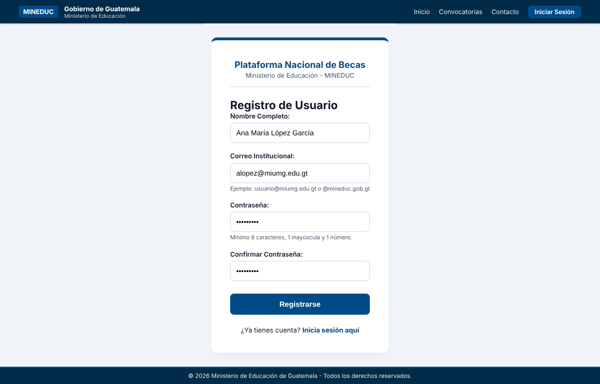

Si todo está correcto, aparece **¡Registro exitoso!** y la plataforma lo lleva
al inicio de sesión.

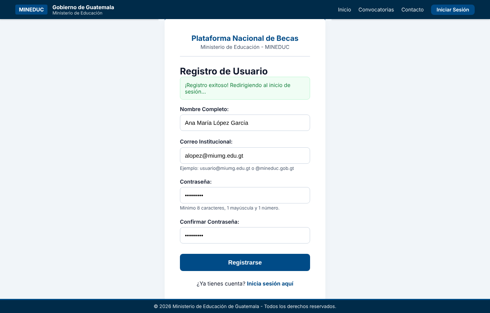

---

## 3. Iniciar sesión

1. Escriba su correo institucional y su contraseña.
2. Presione **Acceder al Sistema**.

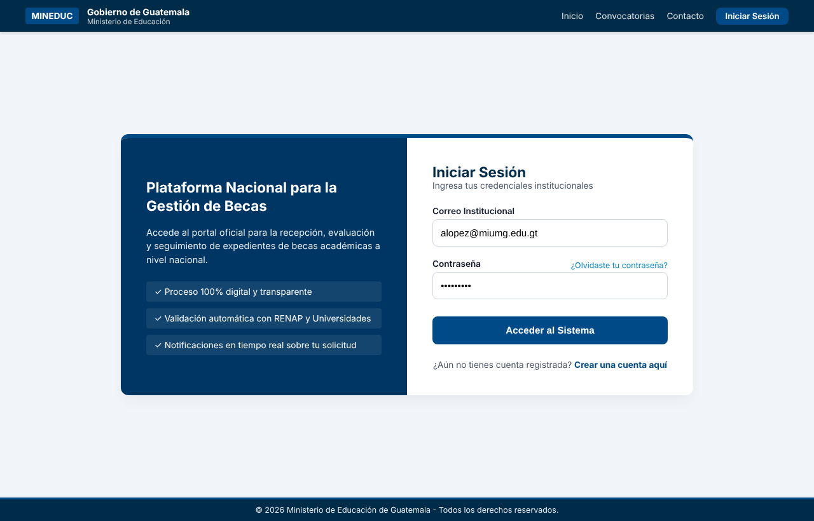

Llegará a la página de inicio, con su nombre, su correo y tres accesos:
**Convocatorias abiertas**, **Mis solicitudes** y **Mis notificaciones**. Desde
aquí también puede **Cerrar sesión**.

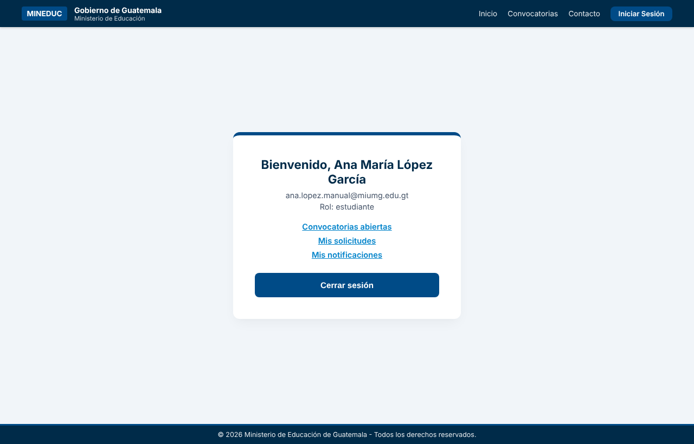

> Si escribe mal el correo o la contraseña, verá **Credenciales inválidas**. El
> mensaje es el mismo en los dos casos a propósito: así nadie puede averiguar
> qué correos están registrados.

> La sesión dura una hora. Si después de ese tiempo aparece el mensaje **Token
> inválido o expirado**, presione **Cerrar sesión** en su página de inicio y
> vuelva a entrar.

---

## 4. Ver las convocatorias

Entre a **Convocatorias** en el menú superior, o a **Convocatorias abiertas**
desde su página de inicio. Esta página se puede ver **sin iniciar sesión**.

Cada convocatoria muestra su nombre, una descripción, las fechas de apertura y
cierre, las modalidades de beca que admite y una etiqueta con su situación:

| Etiqueta | Qué significa | ¿Puede aplicar? |
|---|---|---|
| **Cierran en N días** (verde) | Está abierta y recibe solicitudes | Sí: aparece **Iniciar solicitud** |
| **Abre en N días** (naranja) | Ya se publicó, pero todavía no abre | No, todavía no |
| **Periodo vencido** (rojo) | Ya cerró | No |

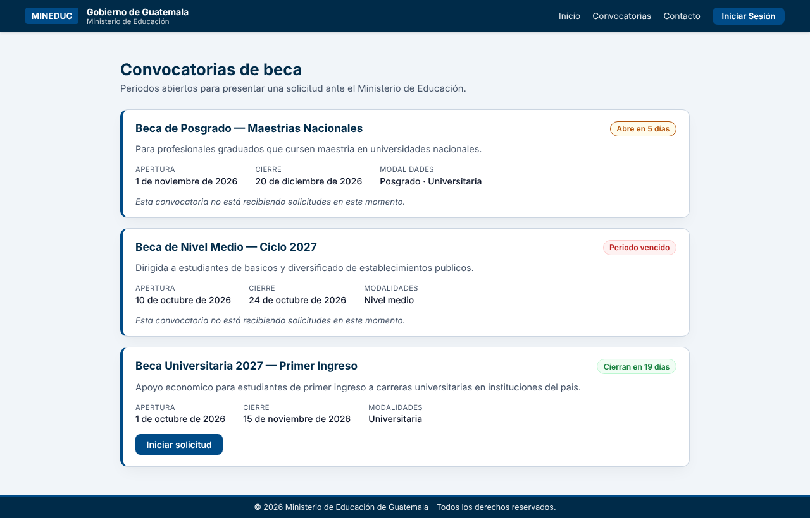

Solo aparecen las convocatorias que el Ministerio ya publicó. Si no hay
ninguna, la página lo dice con un mensaje.

---

## 5. Iniciar una solicitud

1. En la convocatoria que le interesa, presione **Iniciar solicitud**.
   - Si no ha iniciado sesión, la plataforma lo lleva primero al inicio de
     sesión.
   - Si la convocatoria admite varias modalidades (por ejemplo, Posgrado y
     Universitaria), elija la suya en **Modalidad** antes de presionar el botón.
2. La plataforma crea su solicitud en estado **Borrador** y lo lleva a ella.

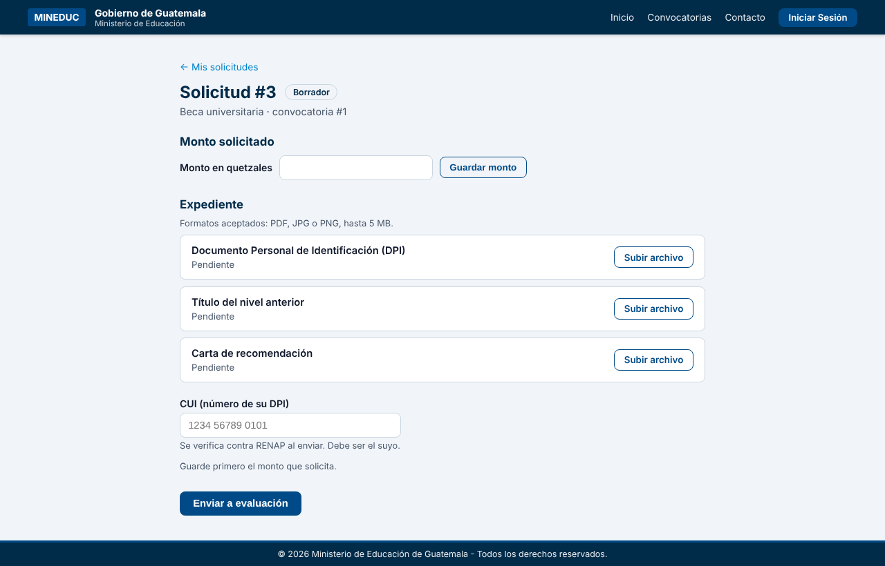

**Solo puede tener una solicitud por convocatoria.** Si ya tiene una y vuelve a
presionar **Iniciar solicitud**, la plataforma lo lleva a la que ya tiene en vez
de crear otra. La única excepción es si su solicitud anterior fue **Rechazada**:
en ese caso sí puede volver a aplicar.

---

## 6. Armar el expediente

El **expediente** es el conjunto de documentos de su solicitud. La plataforma le
muestra **exactamente** cuáles le pide su modalidad:

| Documento | Nivel medio | Universitaria | Posgrado |
|---|:---:|:---:|:---:|
| Documento Personal de Identificación (DPI) | ✓ | ✓ | ✓ |
| Título del nivel anterior | — | ✓ | ✓ |
| Carta de recomendación | ✓ | ✓ | ✓ |

Para subir un documento:

1. Junto al documento que dice **Pendiente**, presione **Subir archivo**.
2. Elija el archivo en su computadora o teléfono.
3. Cuando termine de subir, el documento pasa a **Subido:** con el nombre del
   archivo.

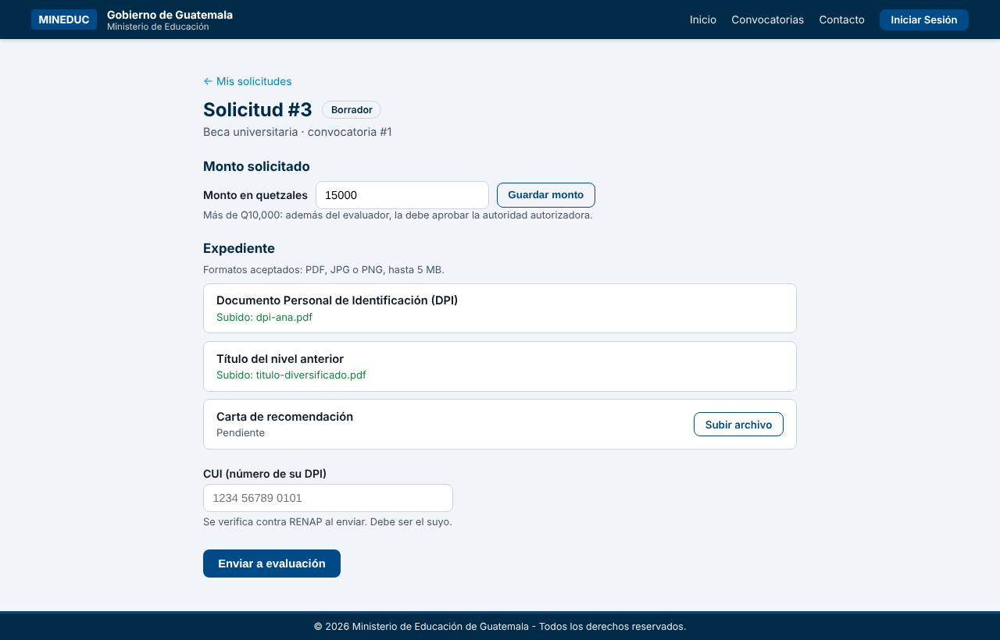

**Formatos aceptados:** PDF, JPG o PNG, de hasta 5 MB. Si el archivo no cumple,
el motivo aparece debajo del documento y no se guarda nada.

> Mientras la solicitud esté en **Borrador** puede subir los documentos en
> varias sesiones: lo que ya subió queda guardado. Un documento ya subido no se
> puede reemplazar desde esta versión de la plataforma.

---

## 7. Enviar la solicitud

### 7.1 Indicar el monto

Antes de enviar, indique cuánto solicita:

1. En **Monto solicitado**, escriba la cantidad en quetzales en el campo
   **Monto en quetzales**: un número mayor que cero, con dos decimales como
   máximo. Por ejemplo, `15000` o `8500.50`.
2. Presione **Guardar monto**. Aparece la confirmación **Monto guardado.**

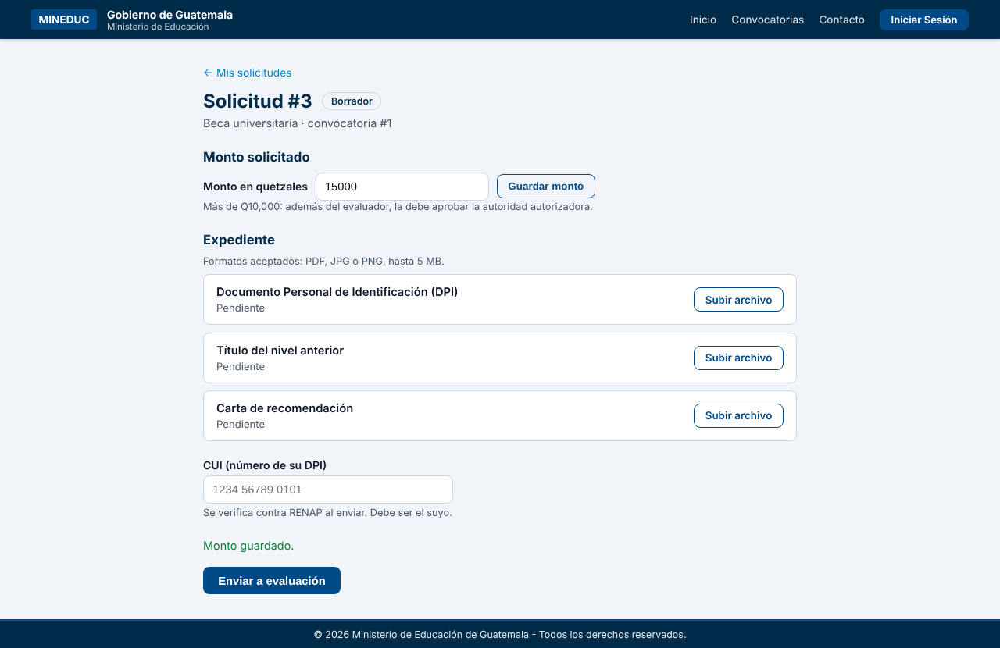

**Si solicita más de Q10,000**, la plataforma le avisa debajo del monto: *Más
de Q10,000: además del evaluador, la debe aprobar la autoridad autorizadora.*
Su solicitud necesitará dos aprobaciones (sección 8). Con Q10,000 exactos o
menos, basta la del evaluador.

Si el monto no es válido (cero, negativo o con más de dos decimales), la
plataforma no lo guarda y muestra el motivo en rojo:

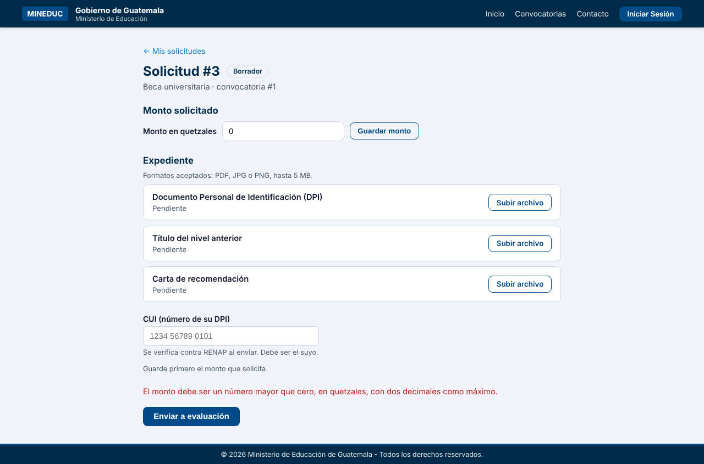

> Puede cambiar el monto las veces que quiera **mientras la solicitud esté en
> Borrador**. Una vez enviada, ya no se puede cambiar.

### 7.2 Enviar

Cuando tenga el monto guardado y todos los documentos:

1. Escriba su **CUI** en el campo **CUI (número de su DPI)**. Puede escribirlo
   con o sin espacios: `1234 56789 0101` o `1234567890101`.
2. Presione **Enviar a evaluación**.

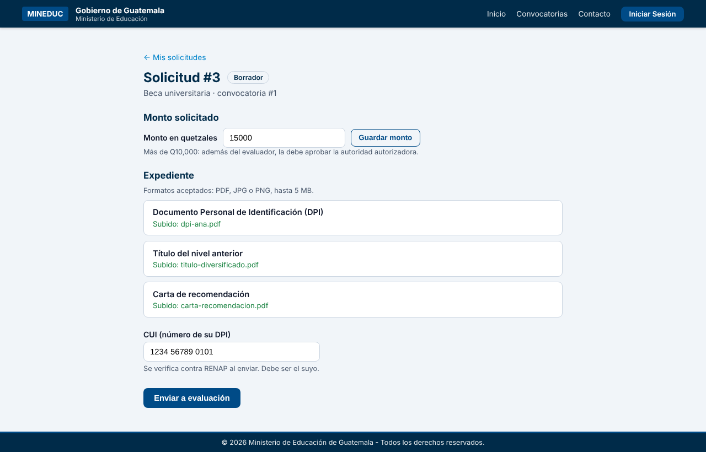

El botón **Enviar a evaluación** queda desactivado mientras el campo del CUI
esté vacío o no haya guardado el monto. Si falta el monto, debajo del CUI
aparece *Guarde primero el monto que solicita.*

### 7.3 Qué revisa la plataforma al enviar, y en qué orden

1. **Que haya indicado el monto.** Sin monto no se envía (sección 7.1).
2. **Que el expediente esté completo.** Si falta algo, le dice exactamente qué
   y marca en rojo los documentos pendientes. La solicitud sigue en Borrador.

   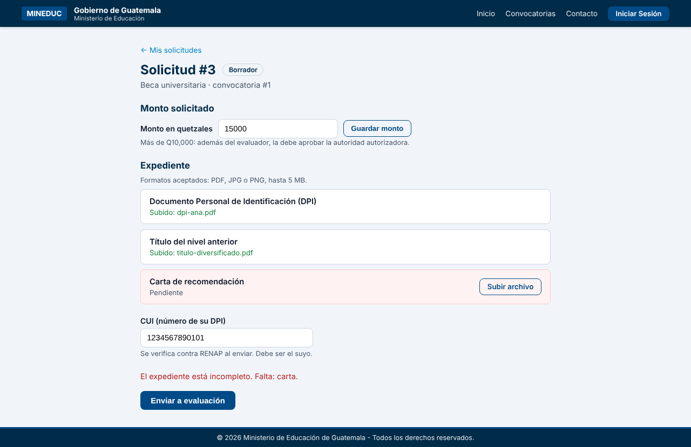

3. **Que el CUI sea suyo.** La plataforma consulta el CUI en RENAP y compara el
   nombre registrado ahí con el de su cuenta. Si el CUI no existe, tiene un
   formato inválido o pertenece a otra persona, no se envía y la solicitud
   sigue en Borrador.

   Si el CUI no existe o es de otra persona, el mensaje es el mismo en los dos
   casos: *No se pudo verificar su identidad con el CUI ingresado.* Es a
   propósito: si la plataforma dijera cuál de los dos pasó, cualquiera podría
   averiguar qué CUI existen y a nombre de quién.

   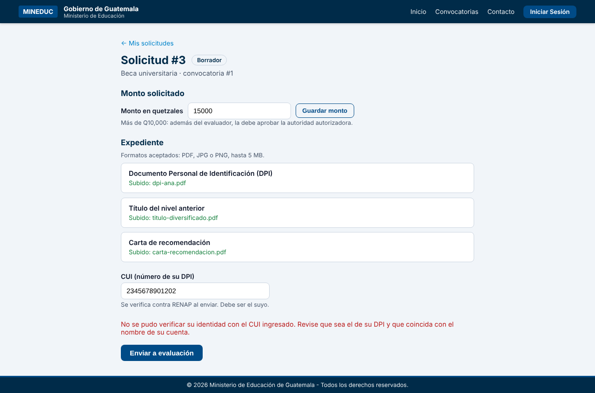

Si todo está bien, la solicitud pasa a **Enviada** y aparece la confirmación
**Su solicitud fue enviada.**

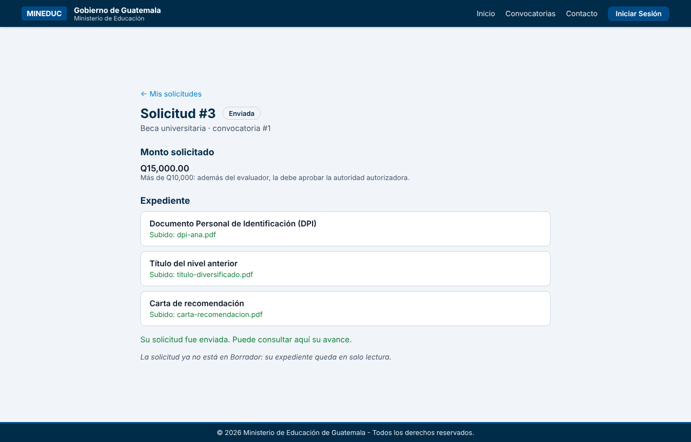

> **Revise todo antes de enviar.** Una vez enviada, la solicitud, su monto y su
> expediente quedan en **solo lectura**: ya no puede cambiar el monto ni subir o
> cambiar documentos.

---

## 8. Después de enviar

Su solicitud avanza por estos estados. Puede consultar en cuál está en cualquier
momento, desde **Mis solicitudes**.

| Estado | Qué significa |
|---|---|
| **Borrador** | La está preparando. Solo usted la ve |
| **Enviada** | La recibió el Ministerio y espera que un evaluador la tome |
| **En Evaluación** | Un evaluador asignado la está revisando |
| **Pendiente de Autorización** | Solo si solicitó más de Q10,000: el evaluador ya la aprobó y espera la segunda aprobación, de la autoridad autorizadora |
| **Aprobada** | Le otorgaron la beca |
| **Rechazada** | No le otorgaron la beca |

**Aprobada** y **Rechazada** son definitivas: una resolución no se puede cambiar
después.

**Becas de más de Q10,000.** Necesitan dos aprobaciones, de dos personas
distintas: primero la del evaluador y después la de la autoridad autorizadora.
Si cualquiera de las dos la rechaza, la solicitud queda **Rechazada**. Con
Q10,000 exactos o menos, la decisión del evaluador es la final.

**Quién aprobó y cuándo.** Al abrir su solicitud, la sección **Aprobaciones**
muestra cada decisión: la etapa (**Evaluación** o **Autorización**), quién la
tomó, el resultado y la fecha y hora.

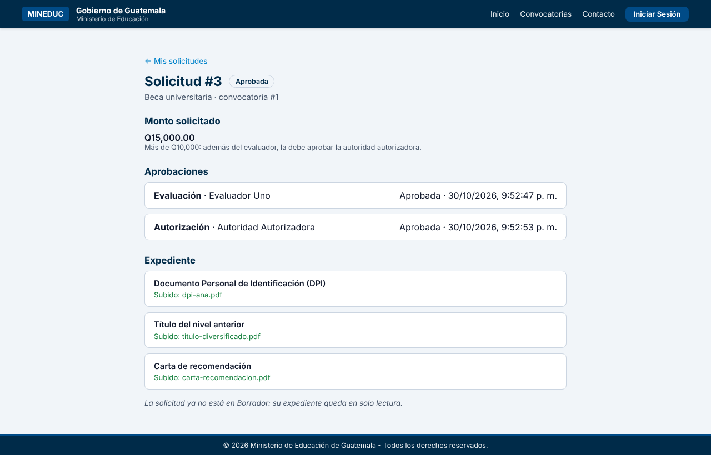

Cada vez que su solicitud cambia de estado, recibe un aviso en **Mis
notificaciones** (sección 9.2).

Solo pueden ver su expediente usted, los evaluadores asignados a su solicitud y
el personal administrador del Ministerio. Ningún otro estudiante puede abrirlo.

---

## 9. Mis solicitudes y notificaciones

### 9.1 Mis solicitudes

Desde **Mis solicitudes** ve todas las suyas, con su número, su modalidad y su
estado. Haga clic en cualquiera para abrir el detalle.

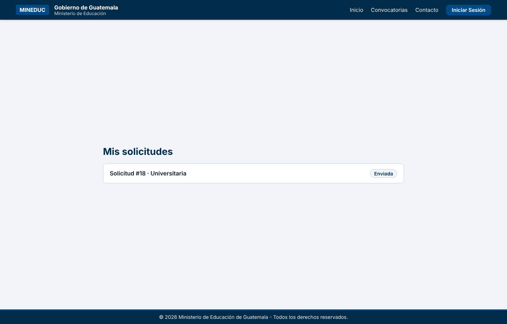

### 9.2 Mis notificaciones

Cada vez que una de sus solicitudes cambia de estado, la plataforma le deja un
aviso. Entre a **Mis notificaciones** desde su página de inicio.

- Los avisos aparecen del más reciente al más antiguo. Cada uno dice de qué
  estado a qué estado cambió su solicitud, a qué solicitud corresponde (con un
  enlace para abrirla) y la fecha y hora.
- Arriba se indica cuántos tiene **sin leer**. Los avisos sin leer llevan la
  etiqueta **Nueva**.
- Presione **Marcar como leída** en un aviso cuando ya lo revisó. Si los leyó
  todos, arriba dice **Todas leídas.**

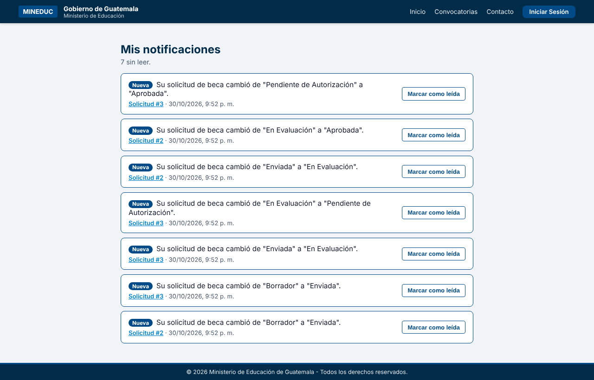

Solo usted ve sus avisos. Si todavía no tiene ninguno, la página dice **No tiene
notificaciones.**

---

## 10. Recuperar la contraseña

> **Esta función está incompleta en la versión actual.** Lea esta sección antes
> de usarla.

La pantalla **Recuperar Contraseña** (enlace **¿Olvidaste tu contraseña?** en
el inicio de sesión) permite pedir la recuperación escribiendo su correo
institucional.

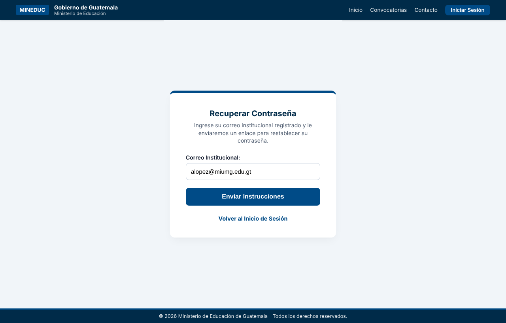

Lo que **todavía no funciona**:

- **No se envía ningún correo.** La plataforma no tiene configurado un servidor
  de correo, así que el enlace de recuperación no le llega.
- **No hay una pantalla para escribir la contraseña nueva.** El paso final de
  la recuperación existe en el sistema, pero no desde la aplicación.

**Mientras tanto:** si olvidó su contraseña, comuníquese con el personal
administrador de la plataforma.

---

## 11. Mensajes frecuentes y qué hacer

| Mensaje | Qué pasó | Qué hacer |
|---|---|---|
| *Solo se aceptan correos institucionales: …* | Usó un correo que no es de un dominio autorizado | Regístrese con su correo institucional |
| *Ya existe una cuenta registrada con ese correo.* | Ese correo ya tiene cuenta | Inicie sesión, o recupere su contraseña (sección 10) |
| *La contraseña debe contener al menos 8 caracteres, una mayúscula y un número.* | La contraseña es débil | Use una que cumpla las tres condiciones |
| *Credenciales inválidas.* | El correo o la contraseña no son correctos | Revise los dos; el mensaje no dice cuál falló, a propósito |
| *El monto debe ser un número mayor que cero, en quetzales, con dos decimales como máximo.* | Escribió un monto inválido | Escriba una cantidad mayor que cero, por ejemplo `15000` |
| *Indique el monto que solicita antes de enviar la solicitud.* | Intentó enviar sin haber guardado el monto | Escriba el monto y presione **Guardar monto** (sección 7.1) |
| *El monto solo se puede cambiar mientras la solicitud está en Borrador.* | La solicitud ya fue enviada | Nada: el monto enviado ya no se cambia |
| *El expediente está incompleto. Falta: …* | Le falta subir algún documento | Suba los que aparecen en rojo y vuelva a enviar |
| *El archivo supera el límite de 5 MB.* | El archivo es muy grande | Reduzca su tamaño, por ejemplo escaneando a menor resolución |
| *… el CUI debe tener exactamente 13 dígitos* | El CUI está incompleto o tiene caracteres de más | Escriba los 13 dígitos de su DPI |
| *No se pudo verificar su identidad con el CUI ingresado. …* | El CUI no existe en RENAP, es de otra persona, o el nombre de su cuenta no coincide con el de su DPI. La plataforma no dice cuál, a propósito (sección 7) | Revise que escribió bien su CUI. Si es el suyo, el nombre de su cuenta no coincide con el de RENAP |
| *El servicio de RENAP no está disponible: …* | El servicio de RENAP no respondió | Su solicitud no cambió. Intente de nuevo más tarde |
| *Token inválido o expirado* | Su sesión venció (dura una hora) | Cierre sesión y vuelva a entrar |
| *No tiene acceso a esta solicitud.* | Intentó abrir una solicitud que no es suya | Entre a **Mis solicitudes** y abra las suyas |
| *La convocatoria … está fuera de su periodo de recepción.* | La convocatoria todavía no abre o ya cerró | Revise sus fechas en **Convocatorias** |

---

## 12. Para evaluadores: revisar y dictaminar

Esta sección es para el personal del Ministerio con rol de **evaluador**. Un
evaluador solo ve y resuelve las solicitudes que el administrador le asignó.

### 12.1 Su cuenta de evaluador

El evaluador se registra igual que cualquier usuario (sección 2), con su correo
institucional. El rol de evaluador **no se elige al registrarse**: lo asigna el
administrador técnico del sistema. Hasta que se lo asignen, su cuenta funciona como la
de un estudiante.

Al iniciar sesión (sección 3), la pantalla de inicio muestra su rol y el enlace
**Bandeja del evaluador**, además de los accesos de cualquier usuario.

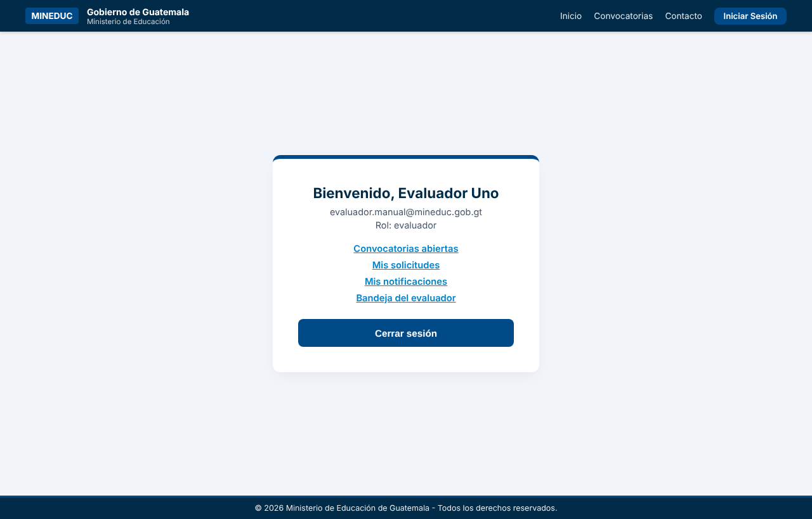

### 12.2 La bandeja del evaluador

Elija **Bandeja del evaluador**. Ahí aparecen, de la más antigua a la más
reciente, todas las solicitudes que le asignaron, en cualquier estado.

Si todavía no le asignaron ninguna, la bandeja lo indica:

Cada solicitud aparece como una tarjeta con su número, su estado, la modalidad
de beca, el número de identificación del estudiante, el **monto** que solicita
y los documentos de su expediente. Si el monto pasa de Q10,000, junto a él
dice *requiere autorización*. Los botones de cada
tarjeta dependen del estado de la solicitud: la plataforma solo muestra las
acciones que se pueden hacer en ese momento.

| Estado de la solicitud | Botones que ve |
|---|---|
| **Enviada** | **Iniciar Evaluación** |
| **En Evaluación** | **Aprobar** y **Rechazar** |
| **Pendiente de Autorización**, **Aprobada** o **Rechazada** | Ninguno: *Sin acciones pendientes* |

### 12.3 Revisar el expediente

En cada tarjeta, el recuadro **Expediente adjunto** lista los documentos que
subió el estudiante, con su tipo y el nombre del archivo. Presione
**Descargar** junto a cualquiera para bajarlo a su computadora y revisarlo.

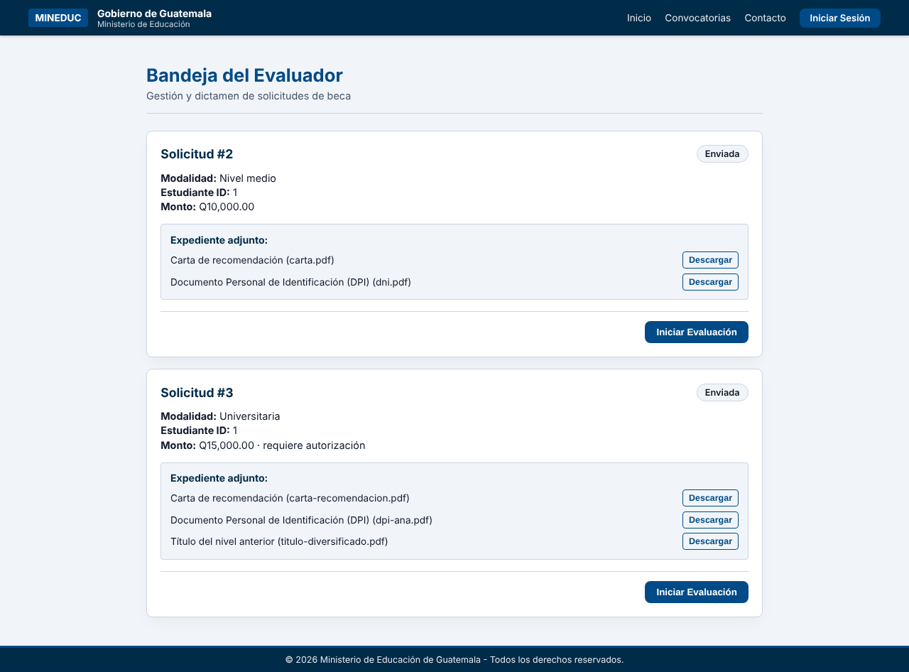

Solo puede descargar los documentos de las solicitudes que le asignaron. El
expediente es de solo lectura: no puede cambiar ni agregar documentos.

### 12.4 Iniciar la evaluación

Una solicitud recién asignada está en **Enviada**. Cuando vaya a revisarla,
presione **Iniciar Evaluación** para tomarla.

La solicitud pasa a **En Evaluación**, aparece la confirmación *Solicitud #…
pasada a "En Evaluación"* y la tarjeta cambia a los botones del dictamen. El
estudiante ve el nuevo estado en **Mis solicitudes**.

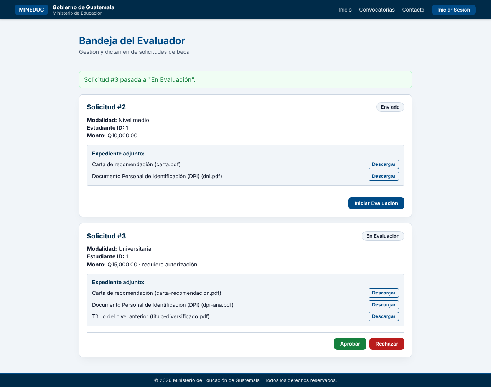

### 12.5 Dictaminar: aprobar o rechazar

Cuando termine de revisar la solicitud, presione **Aprobar** o **Rechazar**.

> **El dictamen es definitivo y se aplica con un solo clic.** La plataforma no
> pide confirmación, y una solicitud **Aprobada** o **Rechazada** ya no se
> puede cambiar (sección 8). Asegúrese de presionar el botón correcto.

La plataforma confirma el estado en que quedó la solicitud, por ejemplo
*Solicitud #2: Aprobada.*, y la tarjeta queda sin acciones pendientes.

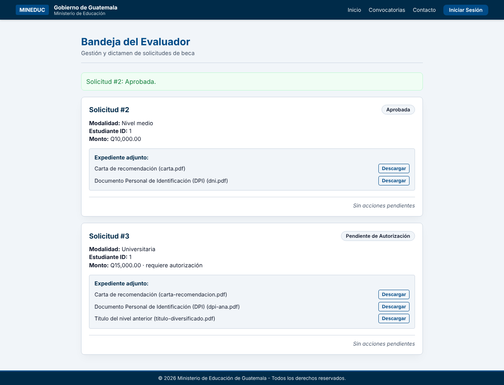

**Si la solicitud pide más de Q10,000, su aprobación no es la final.** Al
presionar **Aprobar**, la solicitud pasa a **Pendiente de Autorización** y la
confirmación lo dice: *Solicitud #3: Pendiente de Autorización.* La decisión
final la toma la autoridad autorizadora (sección 14). Con **Q10,000 exactos** se
aprueba directamente.

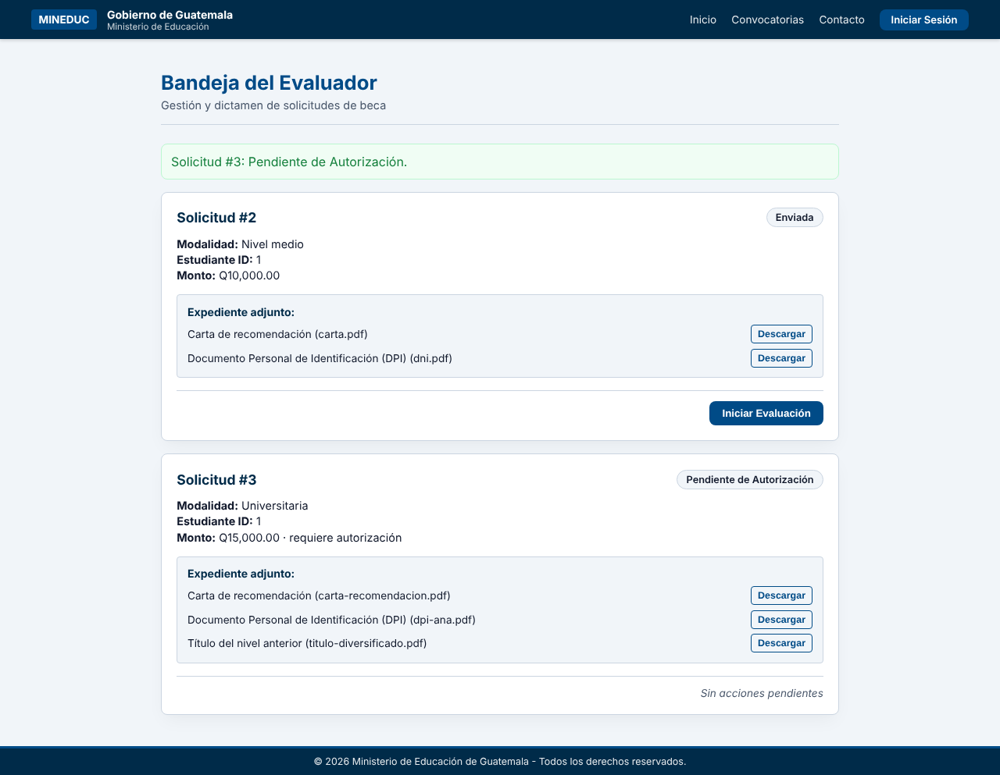

Si la **rechaza**, queda **Rechazada** sin importar el monto: un rechazo no
pasa a la autoridad.

El estudiante ve la resolución en **Mis solicitudes**:

### 12.6 Qué puede y qué no puede hacer un evaluador

- Solo ve las solicitudes que **le asignaron**. Si intenta abrir otra, la
  plataforma responde *No tiene acceso a esta solicitud.*
- Solo puede iniciar la evaluación de una solicitud **Enviada** y solo puede
  dictaminar una que esté **En Evaluación**. La plataforma rechaza cualquier
  otro orden.
- Puede descargar los documentos de las solicitudes que le asignaron, pero no
  modificar el expediente ni subir documentos.
- No puede dar la segunda aprobación de una beca de más de Q10,000: esa le
  corresponde a la autoridad autorizadora, y nunca a quien la aprobó como
  evaluador.

### 12.7 Mensajes para evaluadores

| Mensaje | Qué pasó | Qué hacer |
|---|---|---|
| *No hay solicitudes asignadas para evaluar.* | Todavía no le asignaron ninguna | Espere a que el administrador le asigne una |
| *Solo evaluadores y administradores tienen bandeja de revisión.* | Su cuenta no tiene el rol de evaluador | Pida al administrador que le asigne el rol |
| *No está asignado como evaluador de esta solicitud.* | La solicitud no es de las suyas | Revise que trabaja con su cuenta, o pida la asignación |
| *Token inválido o expirado* | Su sesión venció (dura una hora) | Cierre sesión y vuelva a entrar |

---

## 13. Para administradores: asignar evaluadores y consultar la auditoría

Esta sección es para el personal del Ministerio con rol de **administrador**. El
administrador reparte las solicitudes enviadas entre los evaluadores: una
solicitud solo llega a la bandeja de un evaluador cuando el administrador se la
asigna.

### 13.1 Su cuenta de administrador

Como el de evaluador, el rol de administrador **no se elige al registrarse**: lo
asigna el administrador técnico del sistema. Al iniciar sesión, la pantalla de
inicio muestra tres enlaces que solo ve el administrador: **Bandeja del
evaluador**, **Asignar evaluadores** y **Auditoría**.

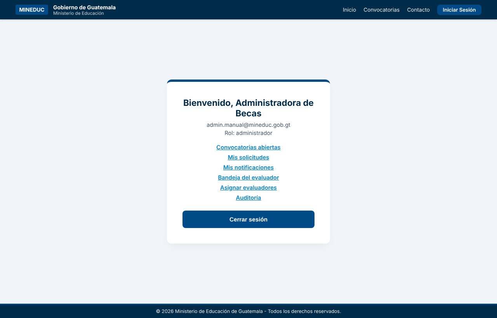

### 13.2 Asignar un evaluador

1. Elija **Asignar evaluadores**. Aparecen las solicitudes que esperan
   revisión (en estado **Enviada**, **En Evaluación** o **Pendiente de
   Autorización**), de la más antigua a la más reciente. Solo se puede asignar
   evaluadores a las que están en **Enviada** o **En Evaluación**: una que ya
   espera a la autoridad responde con el mensaje de la sección 13.4.

   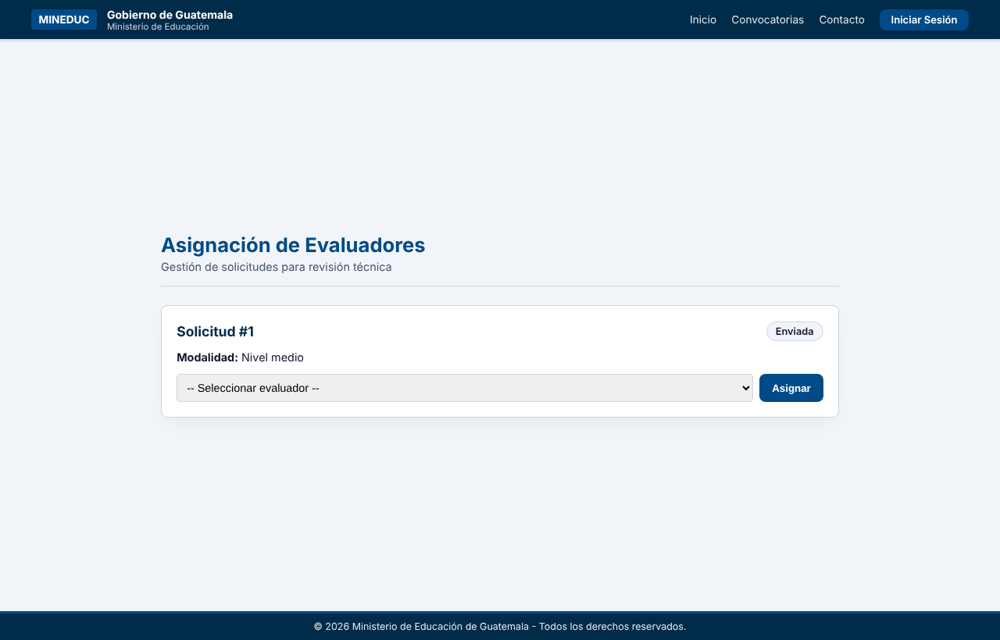

2. En la solicitud que quiere asignar, elija un evaluador en el selector. La
   lista muestra el nombre y el correo de cada usuario con rol de evaluador.

   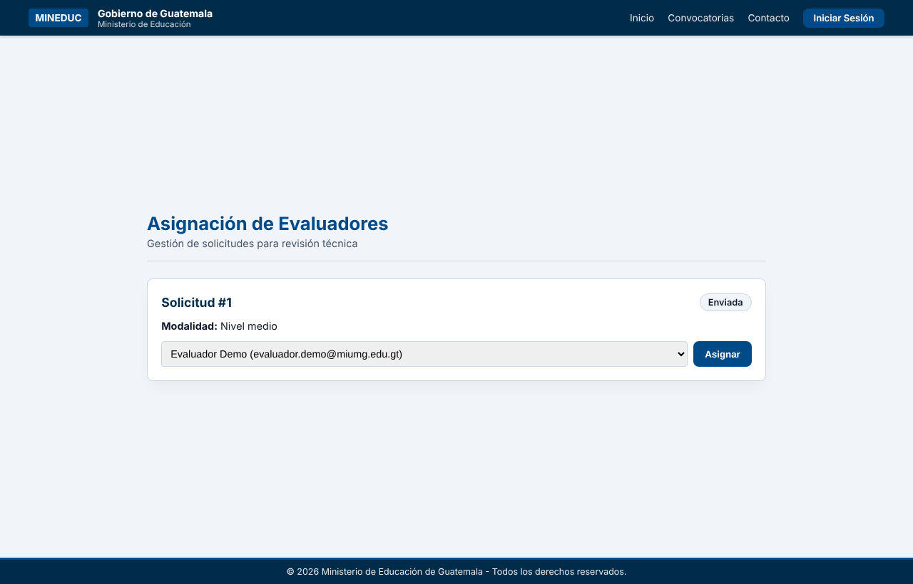

3. Presione **Asignar**. Aparece la confirmación *Evaluador … asignado
   correctamente.* y la solicitud ya aparece en la bandeja de ese evaluador.

   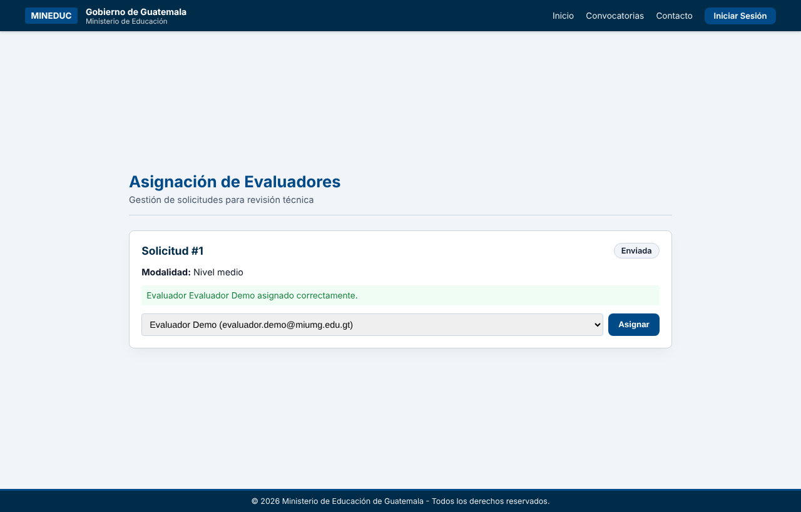

La solicitud sigue en la lista después de asignarla: puede asignarle más de un
evaluador. Si presiona **Asignar** sin elegir a nadie, la plataforma le pide
*Seleccione un evaluador* y no hace nada.

> **La pantalla no muestra quién está ya asignado a cada solicitud.** Si intenta
> asignar a un evaluador que ya tiene esa solicitud, la plataforma se lo dice
> (sección 13.4) y no la duplica.

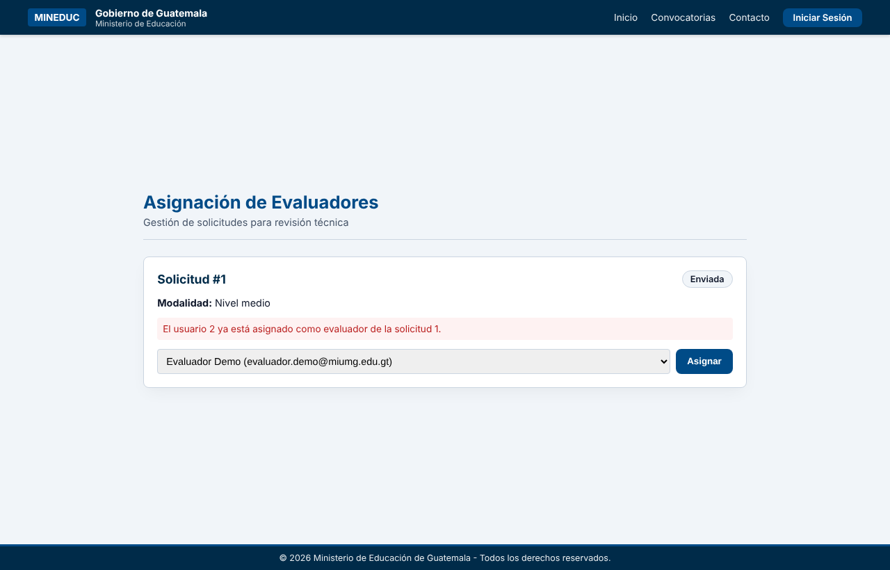

### 13.3 Seguir las solicitudes en revisión

El administrador también puede abrir la **Bandeja del evaluador**. Ahí ve todas
las solicitudes en **Enviada**, **En Evaluación** o **Pendiente de
Autorización**, con sus documentos y su monto, pero **sin botones de acción**:
evaluar y dictaminar le corresponden solo al evaluador asignado, y autorizar,
solo a la autoridad autorizadora. **El administrador no puede autorizar.**

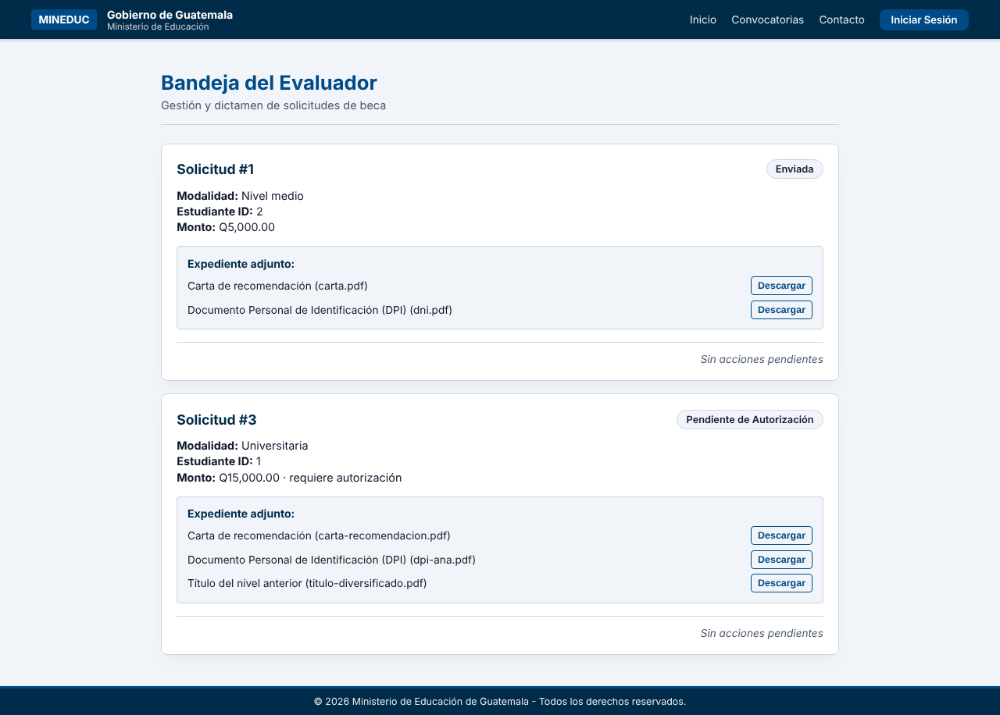

### 13.4 Mensajes para administradores

| Mensaje | Qué pasó | Qué hacer |
|---|---|---|
| *Seleccione un evaluador* | Presionó **Asignar** sin elegir a nadie | Elija un evaluador en el selector |
| *El usuario … ya está asignado como evaluador de la solicitud ….* | Ese evaluador ya tenía esa solicitud | Nada: la asignación ya existe. Si quiere otro evaluador, elija otro |
| *No se asignan evaluadores a una solicitud en estado …: solo en Enviada o En Evaluación.* | La solicitud ya fue aprobada o rechazada, o sigue en Borrador | Nada: una solicitud resuelta no se reasigna |
| *El usuario … no es evaluador.* | El usuario elegido perdió el rol de evaluador | Pida al administrador técnico que revise su rol |
| *Solo un administrador puede asignar evaluadores.* | Su cuenta no tiene el rol de administrador | Pida al administrador técnico que le asigne el rol |
| *Solo un administrador puede consultar la auditoría.* | Su cuenta no tiene el rol de administrador | Pida al administrador técnico que le asigne el rol |

### 13.5 Consultar la auditoría

La plataforma guarda un registro de cada operación importante: quién la hizo,
sobre qué solicitud, cuándo y qué dato cambió. Elija **Auditoría** en su página
de inicio.

La tabla muestra, del registro más reciente al más antiguo:

| Columna | Qué muestra |
|---|---|
| **Fecha** | Día y hora de la operación |
| **Usuario** | Quién la hizo, y su rol |
| **Operación** | Cambio de estado, Aprobación, Cambio de monto, Asignación de evaluador, Subida de documento o Validación de identidad |
| **Solicitud** | El número de la solicitud, con un enlace para abrirla |
| **Detalle** | Qué cambió. Por ejemplo, *Enviada → En Evaluación*, *sin monto → Q15,000.00* o *Autorización: aprobada* |

Para ver solo una solicitud, escriba su número en **Solicitud #** y presione
**Filtrar**. Para volver a ver todo, deje el campo vacío y presione **Filtrar**.

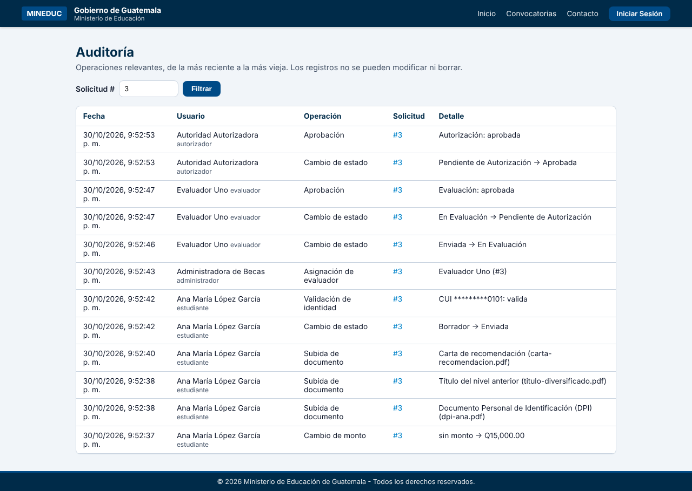

- **Los registros no se pueden modificar ni borrar**, ni siquiera por el
  administrador.
- Solo se registran las operaciones que se completaron: un intento rechazado no
  cambia nada y no deja registro.
- El CUI aparece **enmascarado** (solo los últimos 4 dígitos), y nunca se
  registran contraseñas.
- Solo el administrador ve la auditoría.

---

## 14. Para la autoridad autorizadora: autorizar becas de más de Q10,000

Esta sección es para el personal del Ministerio con rol de **autoridad
autorizadora**. Una beca de más de Q10,000 necesita dos aprobaciones: la del
evaluador y la suya. Usted da la segunda, y solo después de la del evaluador.

### 14.1 Su cuenta

Como los demás roles del Ministerio, el de autoridad autorizadora **no se elige
al registrarse**: lo asigna el administrador técnico del sistema. Si se lo
asignan con la sesión abierta, cierre sesión y vuelva a entrar para que la
plataforma lo reconozca. Al iniciar sesión, la pantalla de inicio muestra el
enlace **Solicitudes por autorizar**.

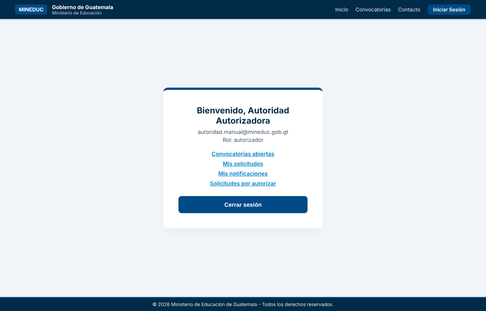

### 14.2 La bandeja de autorización

Elija **Solicitudes por autorizar**. Aparecen las solicitudes de más de Q10,000
que el evaluador ya aprobó y esperan su decisión, en estado **Pendiente de
Autorización**. Cada tarjeta muestra la modalidad, el estudiante, el monto y
los documentos del expediente, que puede **Descargar** para revisarlos.

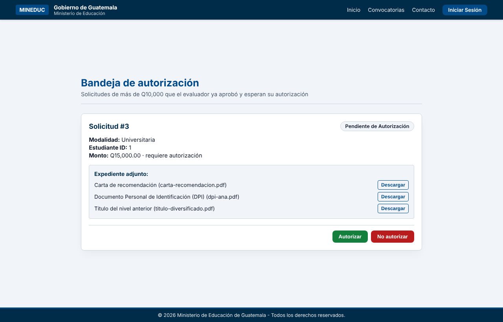

Solo ve las solicitudes que esperan su decisión: no las que todavía están en
evaluación ni las ya resueltas.

### 14.3 Autorizar o no autorizar

Presione **Autorizar** para aprobar la beca, o **No autorizar** para
rechazarla.

> **La decisión es definitiva y se aplica con un solo clic.** La plataforma no
> pide confirmación. Asegúrese de presionar el botón correcto.

La plataforma confirma el estado final, por ejemplo *Solicitud #3: Aprobada.*
Si no la autoriza, queda **Rechazada**. En los dos casos el estudiante recibe
un aviso y ve su resolución, con las dos aprobaciones registradas (sección 8).

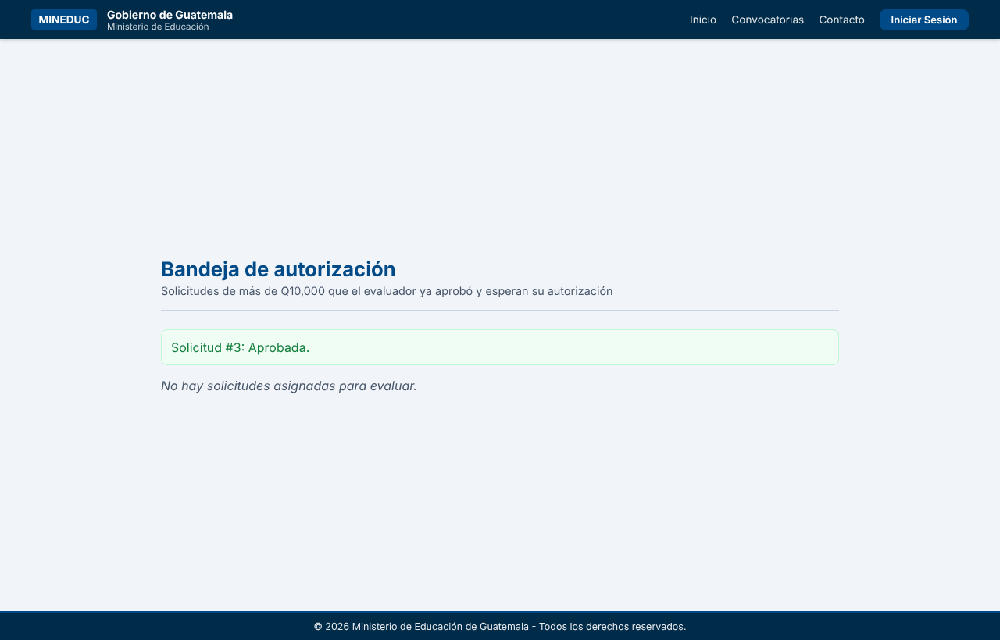

### 14.4 Qué puede y qué no puede hacer

- **No puede autorizar una solicitud que usted aprobó como evaluador.** Las dos
  aprobaciones tienen que ser de personas distintas.
- Solo puede autorizar una solicitud en **Pendiente de Autorización**. Si
  todavía no la aprueba el evaluador, no se puede autorizar.
- No evalúa ni dictamina, y no asigna evaluadores.
- Solo descarga los documentos de las solicitudes que esperan su decisión.

### 14.5 Mensajes para la autoridad

| Mensaje | Qué pasó | Qué hacer |
|---|---|---|
| *La misma persona no puede dar las dos aprobaciones.* | Usted aprobó esta solicitud como evaluador | Otra autoridad debe autorizarla |
| *Solo la autoridad autorizadora puede autorizar la solicitud.* | Su cuenta no tiene ese rol | Pida al administrador técnico que le asigne el rol |
| *No se puede "autorizar" una solicitud en estado "…".* | La solicitud no está en Pendiente de Autorización | Nada: todavía no la aprueba el evaluador, o ya se resolvió |
| *Token inválido o expirado* | Su sesión venció (dura una hora) | Cierre sesión y vuelva a entrar |

---

## 15. Alcance de esta versión

**Lo que cubre este manual.** El recorrido completo del **estudiante**: crear la
cuenta, ver convocatorias, iniciar una solicitud, armar el expediente, enviarlo
con su monto y con validación de identidad, consultar su estado y recibir
avisos de cada cambio. El del **evaluador**: ver las solicitudes asignadas,
revisar y descargar el expediente, iniciar la evaluación y dictaminar. El del
**administrador**: asignar evaluadores, seguir las solicitudes en revisión y
consultar la auditoría. Y el de la **autoridad autorizadora**: dar la segunda
aprobación de las becas de más de Q10,000.

**Lo que todavía no tiene pantallas**, y por eso no se describe aquí:

- **Evaluadores:** el dictamen no admite observaciones ni pide confirmación, y
  la tarjeta identifica al estudiante por su número, no por su nombre.
- **Administradores:** crear, publicar y cerrar convocatorias, y dar el rol de
  evaluador, autoridad autorizadora o administrador a una cuenta. La lógica de convocatorias existe y
  se usa por la API; los roles los asigna el administrador técnico. La pantalla
  de asignación no muestra quién está ya asignado a cada solicitud.
- **Comités, evaluación con puntajes, cupos y reportes:** fuera del alcance de
  esta entrega.
- **Recuperación de contraseña:** incompleta (sección 10).
- **Notificaciones por correo:** los avisos se ven dentro de la plataforma
  (sección 9.2); todavía no se envían por correo.

**Validación de identidad en el entorno de prueba.** En esta versión, la
consulta a RENAP usa un **padrón simulado**, porque el proyecto no tiene acceso
al servicio real. Solo reconoce dos ciudadanos de demostración:

| CUI | Nombre en el padrón simulado |
|---|---|
| `1234567890101` | ANA MARIA LOPEZ GARCIA |
| `2345678901202` | CARLOS PEREZ |

Para probar el envío completo, registre una cuenta con uno de esos nombres (por
ejemplo, *Ana López* o *Ana María López García*) y use el CUI correspondiente.

---

*Documento sujeto a control de versiones en el repositorio del proyecto.*
